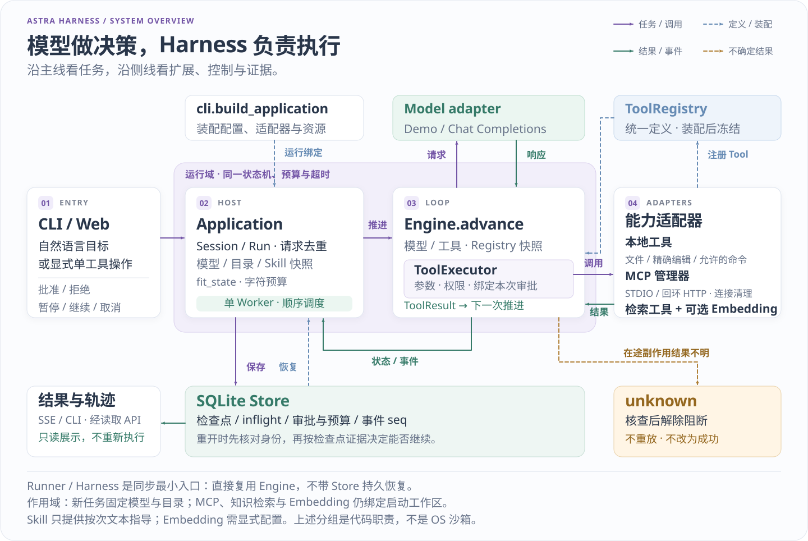
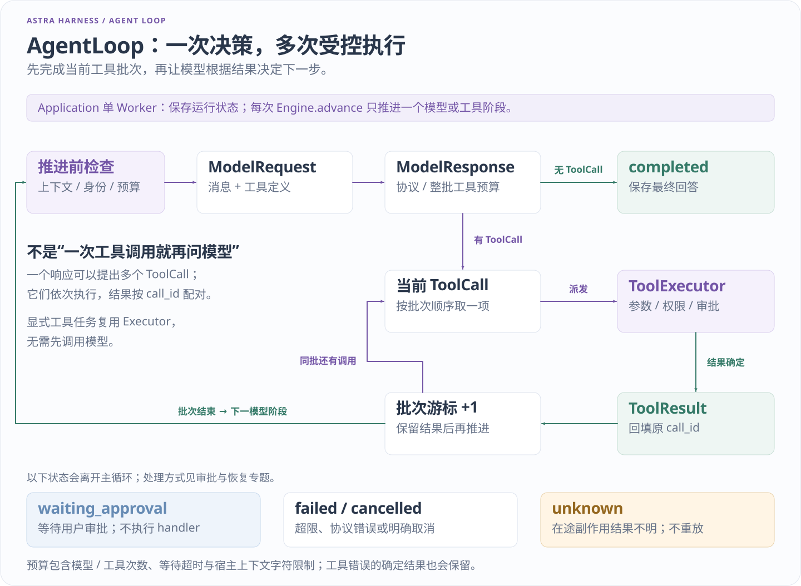
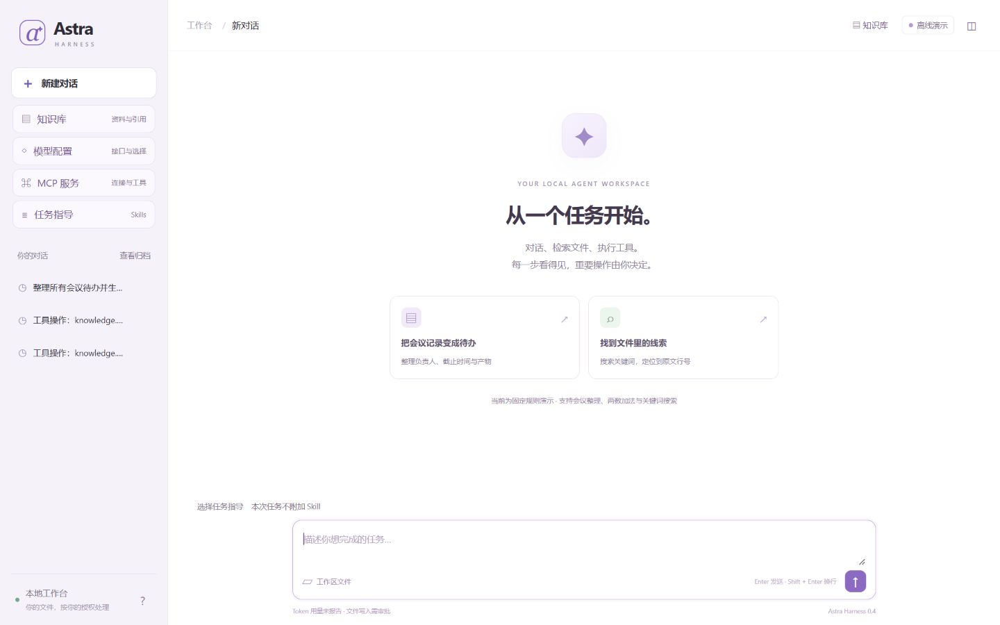

# Astra Harness

**把自然语言目标变成有权限边界、有执行记录的多步骤任务。**

模型负责提出下一步；Astra Harness 负责检查工具调用、保存进度、等待批准，并在异常后判断能否继续。执行内核可以独立使用，本地网页用于操作任务、查看文件和追踪过程。

**当前版本：0.4.0 · 本地单用户。** 功能与变更见 [变更日志](CHANGELOG.md)。

[快速开始](#快速开始) · [运行机制](#运行机制) · [扩展入口](#扩展入口) · [文档地图](docs/README.md) · [当前交接](HANDOFF.md)

## 快速开始

入门命令面向 Windows PowerShell，使用 **Python 3.10+ 和 uv**。第一次运行 Python 项目，可以直接跟随 [新手教程](docs/GETTING_STARTED.md)。

在项目根目录执行：

```powershell
uv sync --locked --inexact
.\.venv\Scripts\python.exe -X utf8 -m astra_harness doctor
.\.venv\Scripts\python.exe -X utf8 -m astra_harness serve --demo-files --port 18765
```

打开 **http://127.0.0.1:18765**，确认页面显示“离线演示”，再输入：

> 整理会议待办并保存 todos.json

1. 查看系统列出文件、读取三份合成会议记录的过程。
2. 写入前检查 `todos.json` 的拟写内容，选择批准或拒绝。
3. 批准后，在文件面板核对 `task`、`owner`、`due`；在执行过程里查看调用与结果。

首次使用全新数据库时，演示无需密钥，不调用外部模型。演示采用固定规则，仅用于验证运行流程。已有数据库会恢复模型档案选择，不能仅凭未传 `--live` 判断不会计费；提交前核对当前模型。`doctor` 是静态检查，不测试模型连通性。

默认工作区是 `.local/workspace/`，状态保存在 `.local/harness.sqlite3`。同一数据库只运行一个宿主进程。更多操作见 [完整演示路线](docs/DEMO.md)。

## 运行机制



先看入口如何进入 Application 和单 Worker，再看 Engine 与模型、工具之间的循环。工具来源可以不同，但本地函数、MCP 和检索工具共用 Registry／Executor 的执行检查。 [查看原图](docs/assets/runtime-overview.svg)

一次任务从 `Application.submit` 进入单 Worker，由 `Engine.advance` 逐步推进。模型提出的调用统一交给 `ToolExecutor`；工具的来源不会改变参数、权限、审批和预算检查。



模型可以返回最终答复，也可以提出一批工具调用；每项工具结果保存后，再进入下一模型阶段。审批、暂停和终止分支决定循环在哪里停下，不表示系统会自动重试未知副作用。 [查看原图](docs/assets/agent-loop.svg)

| 执行中的问题 | 当前处理方式 |
| --- | --- |
| 模型想写文件或执行命令 | 先校验参数与权限，再等待绑定本次调用的审批 |
| 用户希望稍后继续 | 保存阶段、待执行调用和已用预算；暂停中的审批继续后仍需确认 |
| 主机中断，无法确认写操作结果 | 标记 `unknown` 并阻断自动重放，等待人工核查 |
| 工具、模型或目录身份已变化 | 旧运行不能悄悄改用新配置继续 |
| 需要说明发生了什么 | SQLite 保存检查点和事件，CLI 与网页查看同一运行记录 |

Checkpoint 保存进度，但不能让任意外部副作用“恰好执行一次”。模型或只读调用在途退出也不会自动重试。完整分支见 [架构与恢复语义](docs/ARCHITECTURE.md)。

后端使用 **FastAPI、Pydantic、Uvicorn 与 HTTPX**，状态存储使用 **SQLite**，前端是原生 JavaScript 模块与 SSE。Engine 保持独立，Web 模型路径使用异步 I/O；宿主仍以单 Worker 线程调度任务，不能把它理解为多进程执行平台。

## 可以用它做什么

| 能力 | 一个可以核对的结果 | 入口 |
| --- | --- | --- |
| 本地文件任务 | 搜索与行号定位、分段读取、带内容校验的编辑与恢复 | [基本工具](docs/CORE_TOOLS.md) |
| 长任务控制 | 审批、暂停、继续、取消、历史轨迹和未知结果核查 | [演示](docs/DEMO.md) |
| 自选工作区 | 新会话绑定所选目录，旧运行保留原目录身份 | [工作区](docs/WORKSPACES.md) |
| 有来源检索 | 本地词法索引，返回路径、片段与来源校验信息 | [知识检索](docs/KNOWLEDGE.md) |
| 可选语义检索 | 用户自配 embedding 服务，显式审批后建索引或查询 | [Embedding](docs/EMBEDDING.md) |
| 自定义任务指导 | 本地 `SKILL.md`，按次选择并冻结内容快照 | [Skill](docs/SKILLS.md) |



上图用于观察工作台中的任务、执行记录与审批入口，采用本地合成材料。界面截图不代表真实模型的任务成功率；具体操作与验证范围见 [演示路线](docs/DEMO.md) 和 [副本验证状态](HANDOFF.md)。

## 扩展入口

扩展能力由应用组装，核心循环不按供应商或工具来源分支。

| 你想接入的能力 | 入口与职责 | 边界 |
| --- | --- | --- |
| Python 工具 | `tool_from_function` → `ToolRegistry` → `ToolExecutor` | 模型调用仍经过同一执行器 |
| MCP 工具 | 服务管理器发现工具，再适配为统一 `Tool` | 本地 STDIO / 数字回环 HTTP；不是完整 MCP 实现 |
| 任务模型 | 模型协议适配器与用户模型档案 | 当前支持 Chat Completions 兼容协议；密钥留在后端 |
| 检索与 embedding | 检索工具、provider 契约与集合索引 | 默认词法离线；外部向量服务需自行配置 |
| Skill | 本地目录加载与 `task_context` 快照 | 文本指导不授予权限，也不执行脚本 |
| 工作区 | 目录登记、身份校验与运行绑定 | 切换不移动文件，不改变旧任务 |

从 [扩展指南](docs/EXTENDING.md) 编写第一个工具；使用者可直接配置 [模型档案](docs/MODEL_PROFILES.md) 与 [MCP 服务](docs/MCP_PROFILES.md)，无需修改 Engine。

## 验证与评测

项目把“运行时是否遵守规则”和“模型能否完成任务”分开验证：

- 单元与集成回归检查状态、参数、权限、预算、持久化及接口契约。
- 真实子进程退出实验检查恢复窗口、未知结果识别与重复副作用。
- 合成任务用独立产物判据核对结果；固定规则模型成绩不代表 LLM 推理能力。
- 真实模型需另行按任务、输入、模型配置和费用范围验收；本副本不附历史联调报告，不把离线结果当成真实模型成绩。

[评测与实验复现](docs/EVALUATION.md) 解释命令、指标和实验限制；[副本验证状态](HANDOFF.md) 区分实际执行与未执行项。测试数量是覆盖线索，不是质量保证或任务成功率。

## 当前需求的支持与限制

- **本地单用户。** 没有多租户认证、分布式调度或公网部署方案，同一数据库只有一个宿主。
- **权限边界明确，仍不是 OS 沙箱。** 获准运行的本地程序可能访问账号可访问的文件和网络；命令工具默认关闭。
- **配置各有作用域。** 模型选择与工作区切换影响新任务；知识、embedding 和 MCP 仍绑定启动工作区。
- **协议支持有范围。** HTTP MCP 限数字回环地址；没有远程认证与完整协议互通保证。模型、embedding 的真实服务效果需分别验收。
- **上下文是有界字符预算。** 不提供精确 tokenizer 计费控制；未知副作用不通过盲目重试“恢复成功”。

凭据、外部连接和执行风险见 [安全边界](SECURITY.md)。

## 文档导航

| 目标 | 从这里开始 |
| --- | --- |
| 第一次跑起来 | [新手教程](docs/GETTING_STARTED.md) → [演示路线](docs/DEMO.md) |
| 理解 Harness 内核 | [架构](docs/ARCHITECTURE.md) → [源码导读](docs/WALKTHROUGH.md) |
| 接入自己的能力 | [扩展指南](docs/EXTENDING.md) → [配置专题](docs/README.md#按需接入能力) |
| 做可复现实验 | [评测](docs/EVALUATION.md) → [真实模型验收准备](docs/LIVE_ACCEPTANCE.md) |
| 参与开发或讲解版本 | [贡献指南](CONTRIBUTING.md) · [变更](CHANGELOG.md) · [版本说明](docs/VERSION_TIMELINE.md) |

本项目是自主智能体运行框架的学习与工程实践，采用 [MIT License](LICENSE)。代码和文档含 AI 辅助工作；设计取舍、材料来源及许可边界见 [项目来源](docs/PROVENANCE.md)。
