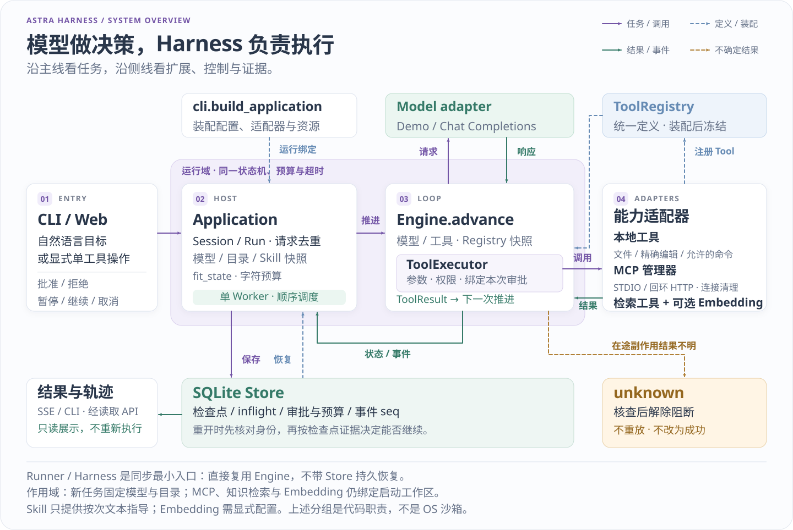
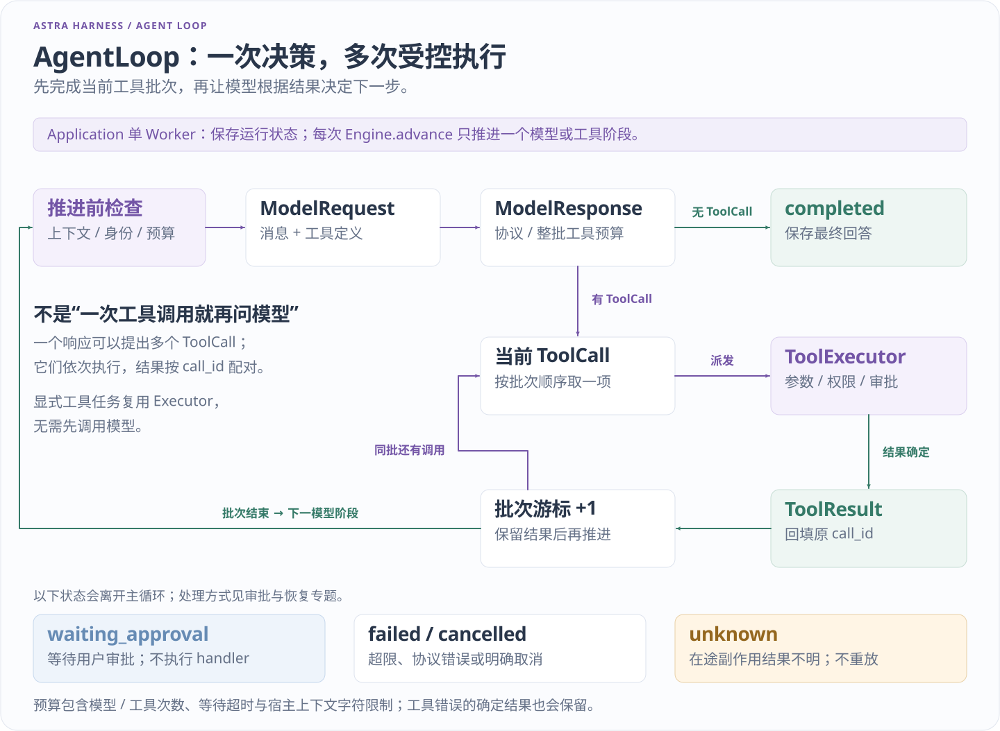
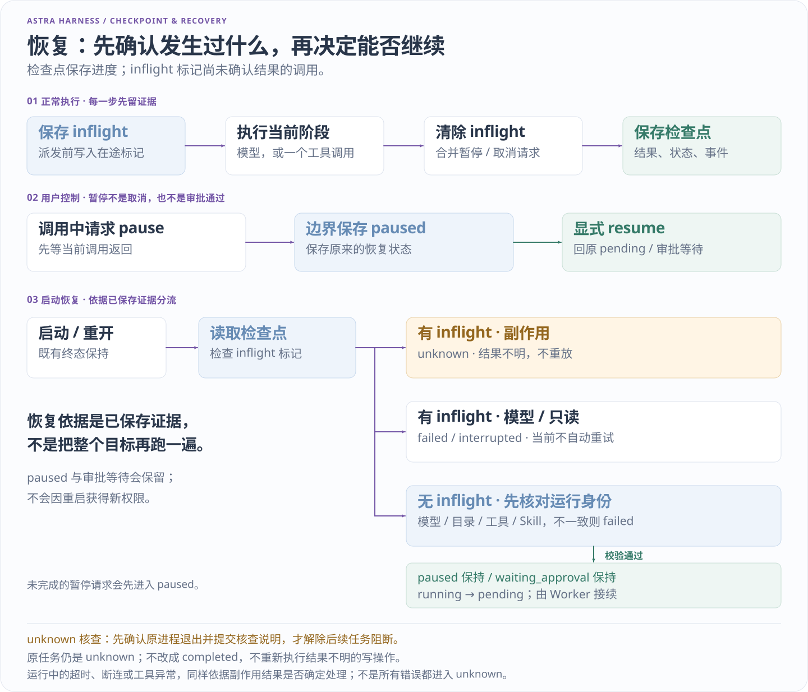
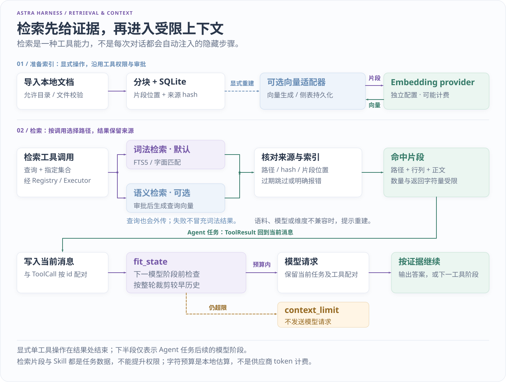

# 架构与运行语义

[项目首页](../README.md) · [文档地图](README.md) · [当前交接](../HANDOFF.md)

这份文档解释 0.4 的执行主线、保存位置与恢复边界。第一次运行请先看 [新手入门](GETTING_STARTED.md)；想沿函数阅读源码，接着看 [源码导读](WALKTHROUGH.md)。实际检查结果见 [交接记录](../HANDOFF.md)。

Astra Harness 的核心是一个可保存进度的执行循环。模型提出答复或工具调用；宿主绑定运行环境，执行器决定调用是否可执行，存储层保存下一次继续所需的状态。网页、模型服务和检索插件都围绕这条主线接入。

## 请求主线



主线从入口经 Application 与单 Worker 进入 Engine，模型和工具通过各自契约接入。Runner／Harness 是复用 Engine 的同步入口，不串在 Worker 调度链路前后。 [查看原图](assets/runtime-overview.svg)

| 组件 | 负责什么 | 边界 |
| --- | --- | --- |
| [CLI 组合根](../astra_harness/cli.py) | 解析配置，装配模型、工具、目录与资源生命周期 | 不另写一套 Agent 循环 |
| [Web 适配](../astra_harness/web.py) | FastAPI 路由、请求校验、SSE、静态页面 | 不在路由中执行模型计划 |
| [Application](../astra_harness/application.py) | 提交与去重、会话和运行绑定、单 Worker、控制与恢复 | 不理解文件整理或检索业务 |
| [Engine](../astra_harness/engine.py) | 推进一次模型或工具阶段，处理限额与状态转换 | 不导入 Web、MCP 或具体文件插件 |
| [Registry / Executor](../astra_harness/tools.py) | 注册定义；统一检查参数、权限、审批并调用处理函数 | 注册表不启动进程，也不授予 OS 权限 |
| [Store](../astra_harness/store.py) | SQLite 中的会话、运行、事件与配置登记 | 不把外部副作用变成数据库事务 |

`Application.submit()` 创建运行后，Worker 保存执行前标记，再调用 `Engine.advance()`。一次推进结束后保存新状态，直到完成、等待审批、暂停或失败。旧 `Harness.run()` 是教学兼容入口，也复用 Engine；没有第二套独立 AgentLoop。



沿循环看模型响应怎样变成工具调用，再看结果如何回到下一轮上下文。批次顺序执行，等待审批时停止推进；执行记录与检查点让继续位置可核对。 [查看原图](assets/agent-loop.svg)

模型响应中的工具参数必须完整解析后才能进入执行器。参数或权限拒绝会产生对应 `ToolResult`，Agent 可以据此继续；等待审批会暂停推进。预算耗尽、协议错误等终止条件则结束运行。同一批次的工具按顺序执行，不并行派发。

## 数据与状态

[contracts.py](../astra_harness/contracts.py) 定义贯穿主线的数据对象：

| 对象 | 内容与用途 |
| --- | --- |
| `ModelRequest` | 当前消息与可用 `ToolSpec`；模型看不到 Python 处理函数 |
| `ModelResponse` | 文本、零个或多个 `ToolCall`，以及可选供应商用量 |
| `ToolCall` / `ToolResult` | 用 `call_id` 配对参数与实际结果 |
| Run | 阶段、消息、待执行批次与游标、预算、审批、绑定快照和在途标记 |
| Session | 已完成任务的用户输入和最终答复；完整工具过程仍在 Run 中 |

| `status` | 含义 | 后续行为 |
| --- | --- | --- |
| `pending` / `running` | 等待调度／正在推进 | Worker 检查边界后继续 |
| `waiting_approval` | 当前调用需要用户决定 | 批准原调用，或拒绝并结束 |
| `paused` | 已停在可保存边界 | 显式继续，恢复原阶段与预算 |
| `completed` | 运行正常结束 | 核对业务结果和实际产物 |
| `failed` / `cancelled` | 明确失败／取消 | 保留记录，不自动重新提交 |
| `unknown` | 副作用是否完成无法确认 | 阻止继续执行，等待人工核查 |

`phase` 与 `status` 不同：暂停运行仍保存自己停在模型阶段还是工具阶段。对直接工具运行，外层 `completed` 只表示调用正常返回；例如命令返回 `ok: false`，调用者仍须检查业务结果。

## 持久化与恢复



恢复先区分“没有发出调用”和“调用已发出但结果未保存”，再检查原配置与等待状态。未知副作用必须保留 unknown；人工核查解除宿主阻断，也不把原运行改成成功。 [查看原图](assets/recovery-flow.svg)

每次实际调用前，Worker 保存 `inflight`；结果确定后才清除标记并保存下一状态。工具准入拒绝或尚未批准时，不记录已派发调用。恢复首先处理在途标记，再判断配置是否仍能支持原运行。

| 重启时的证据 | 当前实现的处理 |
| --- | --- |
| 副作用工具仍有 `inflight` | `unknown / interrupted_effect_unknown`；不重放 |
| 模型或只读调用仍有 `inflight` | `failed / interrupted`；不自动重试 |
| 无在途调用，目录／模型／工具绑定不兼容 | 明确失败并保留原因 |
| 无在途调用，原状态为 `running` | 回到 `pending`，从保存的阶段与游标继续 |
| 原状态为 `waiting_approval` 或 `paused` | 保留等待或暂停，不因重启自动批准 |
| 已经终止 | 保留原结果 |

已保存的工具结果不会因正常继续而重复执行，但“副作用已经发生、结果尚未落盘”仍是本地检查点无法消除的窗口。因此没有任意工具的 exactly-once 保证，也没有自动对账或补偿。

未解决的 `unknown` 阻止新提交和 Worker 继续执行。人工核查要求先确认原进程已经退出，再检查实际文件或外部系统并填写说明。`resolve_unknown()` 只保存说明并解除该记录的主机阻断，**原运行仍是 unknown**，不会伪造成功或重放工具。原进程存活、身份无效或无法确认退出时拒绝解除。

请求 ID 同时检查输入一致性。完成状态与会话历史追加在同一 SQLite 事务中保存；事件有持久序号，SSE 重连从游标继续读取。读取事件或 CLI `inspect` 不执行工具。删除会话会删除对应运行与请求 ID，不能继续依赖已删除记录去重。

## 暂停与继续

待执行或待审批运行可以立即保存为 `paused`。调用进行中，`pause()` 只保存 `pause_requested`，等当前调用完成并落盘后，在下一次调用前暂停；它不取消网络请求、不强杀同步线程，也不提前判断写入结果。

继续保留原消息、阶段、批次游标、审批、计数和累计耗时，不新建 Run 或补发预算。暂停的审批必须先继续回到 `waiting_approval`，然后仍需批准或拒绝。暂停占用原会话，其他会话可以调度。操作示例见 [演示路线](DEMO.md)。

## 上下文与预算



会话与当前任务内容先按预算组装，模型调用检索工具后，返回片段再作为普通 ToolResult 进入当前轮。Skill 和检索材料都只是任务上下文，不授予工具权限；可选向量服务仍需显式配置与审批。 [查看原图](assets/context-retrieval.svg)

[context.py](../astra_harness/context.py) 计算消息与工具描述的 JSON 字符数，默认上限为 48,000；这不是精确 token 数。它只裁剪完整旧用户轮次，保留 system、当前用户输入与当前轮工具配对。仍超限时，在模型请求前以 `context_limit` 失败。

运行保存创建时的完整 limits。模型次数在阶段开始时预占；工具拒绝也计次数，等待审批不计。模型返回工具批次后先检查剩余工具预算，不足时整批不执行。

累计时间衡量各段执行耗时，不包含审批等待、主动暂停、进程离线与排队时间。阶段入口和调用等待期间检查限额；保存与观察者开销可能使最终记录略超上限。它不是跨重启墙钟截止时间，也不是供应商费用硬上限。

## 服务与调用边界

Web 使用 FastAPI、Pydantic、Uvicorn，依赖由 [uv.lock](../uv.lock) 固定。服务仅绑定 `127.0.0.1`、单 Uvicorn worker；同一数据库只允许一个主机进程。当前没有用户认证、多租户或公网部署模式。

ASGI 负责 HTTP 连接。Application 自己的线程顺序推进 Engine；同步路由与 SSE 数据库读取交给线程池。断开 SSE 只结束订阅，不取消任务；不能通过增加 Uvicorn workers 共享数据库。

Engine 能有界等待同步函数或异步协程。真实模型使用 HTTPX 异步传输，每次调用拥有自己的客户端，避免在不同调用的事件循环间复用连接。取消是尽力通知：同步处理函数不能强杀，取消网络等待也不能证明供应商已停止计算或计费。有副作用调用超时、取消或返回不确定结果时，继续采用 unknown 边界。

## 插件与适配

核心依赖契约，具体能力由 CLI 或可信宿主装配。函数工具和 MCP 工具都成为同一种 `Tool`，经过同一个 Registry 与 Executor；配置页面不创建第二条执行路径。

| 能力 | 接入位置与边界 | 用法 |
| --- | --- | --- |
| 任务模型 | `Model.complete`、可选 `stream`；运行冻结档案身份 | [模型档案](MODEL_PROFILES.md) |
| 本地工具 | `Tool`、`tool_from_function`、`PluginManager`；统一检查与清理 | [扩展指南](EXTENDING.md) |
| MCP | `MCPServiceManager` 发现并适配为 Tool；manager 持有连接 | [MCP](MCP.md)、[档案](MCP_PROFILES.md) |
| Skill | 工作区文本经复核、单次选择、冻结正文；不执行脚本或授予权限 | [Skill](SKILLS.md) |
| 知识检索 | `KnowledgePlugin` 返回来源片段；普通 ToolResult 进入上下文 | [知识检索](KNOWLEDGE.md) |
| Embedding | provider 异步 `embed(texts)`；显式启用与审批 | [Embedding](EMBEDDING.md) |
| 工作区 | `WorkspaceBinding` 与宿主目录工厂；旧运行保留原绑定 | [工作区](WORKSPACES.md) |

`ToolExecutor.check()` 依次检查工具存在、参数、权限和审批。当前 Schema 支持基础类型、必填项、额外字段、枚举及基本大小／数值约束，未知关键词被拒绝；它不是完整 JSON Schema 实现。工具说明、Skill 正文和检索材料都不能代替这些检查。

`PluginManager` 负责构建期注册与逆序清理，失败时撤销本次新增注册。MCP 各服务拥有独立连接、命名空间和状态；动态档案只在宿主预约的安全边界发布新工具集合。未知结果不自动重连重试，配置变化也不能沿用旧审批。当前 MCP 支持 STDIO 与数字回环 HTTP 工具子集，没有远程认证、GET 通知订阅、过期会话自动恢复、资源或 sampling。

协议参考：[Chat Completions 流式事件](https://developers.openai.com/api/reference/resources/chat/subresources/completions/streaming-events)、[stream_options](https://developers.openai.com/api/reference/resources/chat/subresources/completions/methods/create)、[DeepSeek 工具调用](https://api-docs.deepseek.com/guides/tool_calls/)，MCP 2025-06-18 的 [传输](https://modelcontextprotocol.io/specification/2025-06-18/basic/transports)、[生命周期](https://modelcontextprotocol.io/specification/2025-06-18/basic/lifecycle)和[工具](https://modelcontextprotocol.io/specification/2025-06-18/server/tools)。这些是实现依据，不代表完整协议兼容。

## 配置与运行绑定

| 配置项 | 何时生效 | 已有运行 |
| --- | --- | --- |
| limits、context_chars | 启动时严格校验 | 保留原 limits；上下文变化不能绕过恢复检查 |
| 模型档案 | 用户选择后用于新任务 | 冻结档案修订与凭据绑定；同会话不能静默换模型 |
| MCP 档案 | 保存不连接；显式测试或启用才连接 | 保存意图与活动连接分开，重开不自动启动动态服务 |
| Skill | 复核启用，再为单次任务选择 | 保存正文快照；源文件修改不替换旧指导 |
| 工作区 | 元数据校验、确认后用于新会话 | 审批、继续与预览仍使用原目录身份 |
| Embedding | 保存非秘密字段，重启加载 | 区分 active／saved；待重启时拒绝新语义操作 |

启动配置文件只接受已支持字段与有限大小，不执行文件内容。模型 `.env` 仅在显式指定 `--env-file` 时读取三个既有 ASTRA 字段，进程同名环境优先；档案只保存密钥环境变量引用。`doctor` 做静态检查，不请求模型、不启动 MCP，也不证明数据库锁或服务连通性正常。细节见 [安全边界](../SECURITY.md)。

## 工作区选择与运行绑定

目录选择使用后端已存在目录的绝对路径输入，不是上传或浏览器文件夹选择器。校验只检查元数据；确认时重验目录身份与选择修订号。会话保存 `workspace_id`，运行还保存路径、物理身份与绑定快照。目录失效时报告不可用，不改投其他目录。

同一数据库固定启动目录。Web 恢复保存的选择，CLI 新任务仍使用 `--workspace`；已有运行控制遵守原绑定。其他选定目录获得本地文件工具，以及按宿主白名单启用的命令工具。MCP、知识集合和 embedding 仍绑定启动目录，不自动跨目录装配。

文件插件拒绝越界、隐藏或常见凭据名称、链接、Windows reparse/junction 和多硬链接普通文件，并限制读写大小。条件编辑要求 SHA 与唯一旧文本匹配，写入前保存恢复记录；命令默认关闭，白名单程序使用 argv、最小环境与进程树清理。这些保护不是 OS 沙箱，获准程序仍拥有服务账号能力。详见 [基本工具](CORE_TOOLS.md)。

## 文件片段读取

`files.read_range` 与旧 `files.read(path)` 并存，仍需 `files.read` 权限。它减少送入上下文的文本量，不扩大允许读取的文件范围。

| 参数 | 语义 |
| --- | --- |
| `path` | 工作区内普通文件的相对路径 |
| `start_line` | 从 1 开始、包含此行；默认 1 |
| `start_column` | 第一行中从 1 开始的 Unicode 码点位置；默认 1，不是字节偏移 |
| `line_count` | 最多读取的逻辑行数；默认 40，上限 100 |

每次最多返回 2,000 个文本码点、100 个片段，元数据另计入上下文。每段包含 `line`、`start_column`、`text`、`partial`。`next_cursor` 指向首个未返回位置；`truncated` 当且仅当游标非空。长单行可能需要同一行多次续读，不能只递增行号。

```json
{"path":"notes.txt","start_line":2,"start_column":1,"line_count":1}
```

续读将返回游标的 `start_line`、`start_column` 与同一路径一起传入。返回文本不含换行符，CRLF 算一个边界；末尾换行不虚构额外空行，BOM 保留为首个码点。空文件只接受起点 `(1,1)`，越界不静默挪动位置。预期文件或范围错误返回 `value.ok: false`、固定错误码和提示，不能只看外层 `error_code`。

实现以固定小块扫描到 EOF、严格增量解码，只保留有界片段；文件尾编码、NUL 和总字节数仍检查。单文件上限保持 128,000 字节，每次续读消耗预算。不承诺随机定位或更少磁盘扫描；文件可能在两次读取间变化，游标不是快照。量测见 [片段对照](EVALUATION.md#文件片段与上下文对照)。

## 流式事件与用量

模型可以先返回文本增量，但工具参数必须拼接完整、通过结束标记和 JSON 校验后才成为调用。断流或非法响应不会执行半个工具，迟到文本在超时或取消后被丢弃。

`model.end` 记录耗时、首个文本片段时间和可选 usage；运行只汇总收到的成功响应统计。未报告用量不能解释为零成本，取消也可能已经计费。规则 DemoModel 不伪造 token 用量或通用语言理解能力。真实模型范围单独记录于 [评测](EVALUATION.md)。

## 可选的本地知识索引

知识索引是内建扩展，不在 Engine 内。默认用 SQLite FTS5 做字面词法匹配，短词采用有界扫描，不等同语义检索。静态集合各有材料根、索引和具名权限，索引不放在材料目录内。

导入、更新和移除经审批；源与索引摘要用于拒绝过期批准。查询返回经当前原文核对的路径、行列与片段，不能保证文件此后不变。材料与结果以普通上下文数据进入模型，不覆盖系统策略。

## 可选 embedding 的适配边界

使用者显式配置 OpenAI-compatible embeddings 服务后，可以生成、保存与查询真实向量。provider 在集合装配时注入，工具走原执行器；测试、重建和查询会发送数据并可能计费，因此需要审批。

重建与查询绑定语料摘要；配置、维度或语料不兼容会要求重建。查询核对来源，不把失败替换成词法结果。SQLite 向量旁库保存向量及片段身份，不重复保存正文；每库最多 128 个片段、每批 8 个。离线 mock 验证协议与数值流程，不能证明真实模型语义质量。

## 工作台的单工具运行

知识库等明确操作由宿主选择已注册工具，`Application.submit_tool()` 创建 `kind=tool` 的运行。它复用检查点、权限、审批、预算和 unknown 门禁；工具执行后保存结果并结束，不调用模型。结果留在 Run／trace，不伪装为 assistant 聊天答复。

参数、运行类型与 request_id 绑定；响应丢失时查询原请求，不换 ID 自动重做。网页预览和目录 GET 只读，预览失败或重开页面不能批准工具。

## 评测工具身份

[tool_identity.py](../astra_harness/tool_identity.py) 为 benchmark 记录 Schema、权限、副作用／审批策略、显式实现版本、函数源码 AST、声明辅助函数与常量的规范摘要。基线失配在执行前拒绝，工作区绑定后再检查一次；旧报告缺失的身份不回填。

说明文字另记 presentation 摘要，仅描述变化会提示变化而不当作工具语义契约改变。顺序规范化不代表模型输入字节相同；AST 摘要也不证明语义等价、未声明依赖完整、远端行为一致或供应链可信。

评测身份与运行恢复快照用途不同：前者判断实验能否比较，后者控制旧运行是否还能继续；不能互相替代。具体条件、产物判据与实测结果见 [评测协议](EVALUATION.md)。
