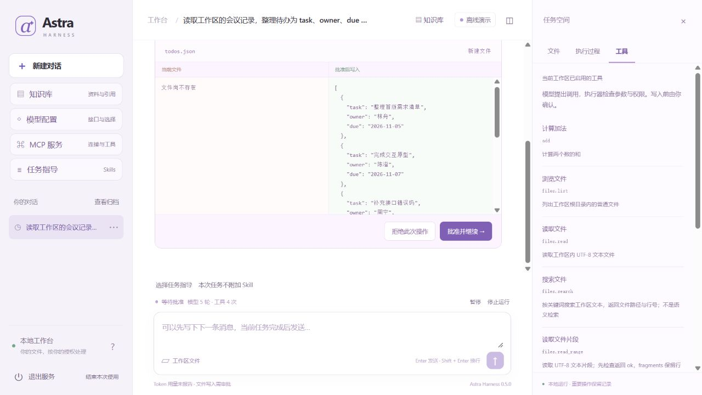
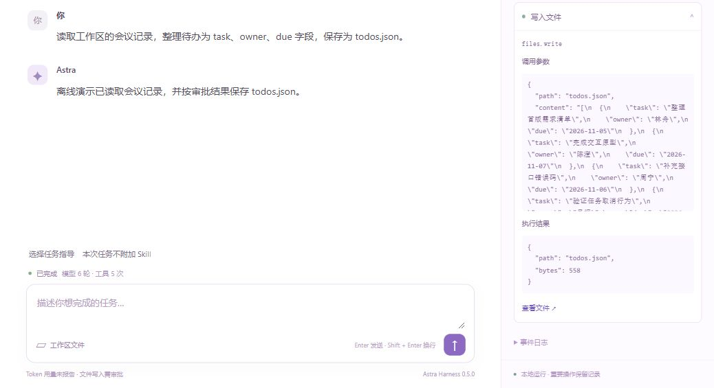

# 演示路线：从任务到可核对的执行结果

[项目首页](../README.md) · [文档地图](README.md) · [验证状态](../HANDOFF.md)

这份路线用于本地讲解和录屏，主线展示文件任务、写入审批与跨进程继续，附录解释安全边界和未知副作用。使用独立目录和虚构样例，不需要模型密钥。按讲解需要选择主线或故障附录。

示例使用固定规则模型：自然语言输入触发预设计划，文件读取和写入实际发生。它能证明 Harness 的执行规则，不能冒充大语言模型自主规划。第一次使用项目先看 [新手入门](GETTING_STARTED.md)。

## 主线：目标、审批、暂停与继续

在项目根目录的同一个 PowerShell 窗口依次执行各段。需要 Python 3.10+ 和 uv；先安装锁定依赖。下面不带 `--live` 或 `--env-file`，不会请求模型供应商。

### 1. 创建本次独立目录

```powershell
$ErrorActionPreference = "Stop"
[Console]::OutputEncoding = [System.Text.UTF8Encoding]::new($false)
$OutputEncoding = [Console]::OutputEncoding
uv sync --locked --inexact
if ($LASTEXITCODE -ne 0) { throw "依赖安装未完成。" }
$demoPython = ".\.venv\Scripts\python.exe"
if (-not (Test-Path -LiteralPath "astra_harness/cli.py")) {
    throw "请先切换到项目根目录。"
}
$demoRoot = Join-Path (Get-Location).Path (".local/demo/session-" + [guid]::NewGuid().ToString("N"))
if (Test-Path -LiteralPath $demoRoot) {
    throw "演示目录已存在，请重新执行本段生成新目录；不要删除或覆盖旧数据。"
}
New-Item -ItemType Directory -Path $demoRoot -ErrorAction Stop | Out-Null
$demoWorkspace = Join-Path $demoRoot "workspace"
$demoDatabase = Join-Path $demoRoot "runs.sqlite3"
$cliPaths = @("--workspace", $demoWorkspace, "--database", $demoDatabase)
$todoPath = Join-Path $demoWorkspace "todos.json"
& $demoPython -X utf8 -m astra_harness doctor @cliPaths
```

编码设置只影响当前终端，使 UTF-8 的 Python 输出能正确进入 PowerShell JSON 管道，不修改系统区域或全局配置。每次准备生成新的 `session-…` 目录。旧演示原样保留；如果目录已存在或命令失败，应停下来检查，不复用旧运行 ID，不通过删除锁文件解决占用。`doctor` 只检查配置和基本路径条件，不创建数据库，也不验证实际锁或供应商连接。

讲解重点：**工作区决定工具能操作哪里，数据库保存这次任务如何执行。** 它们都与默认个人工作区分开。

### 2. 提交目标，停在写入审批

```powershell
$waiting = & $demoPython -X utf8 -m astra_harness run "整理会议待办并保存 todos.json" --demo-files @cliPaths | ConvertFrom-Json
if ($LASTEXITCODE -ne 0 -or $waiting.status -ne "waiting_approval") {
    throw "未到达预期的写入审批，请检查输出。"
}
$runId = $waiting.id
$waiting | Select-Object id, status, model_calls, tool_calls
$waiting.approval | ConvertTo-Json -Depth 12
Test-Path -LiteralPath $todoPath
```

展示三份会议样例已被读取、写入参数已提出，但 `Test-Path` 仍为 `False`。审批内容来自待执行调用；提出写入不等于已执行。这个 CLI 进程在输出后已经退出，状态留在 SQLite 中。

讲解重点：**模型提出 ToolCall，执行器检查参数、权限和审批，工具处理函数才真正写文件。** 查看 [架构](ARCHITECTURE.md#请求主线) 对应这条调用链。



上图展示待审批的调用内容，此时尚未写入文件。批准后，可在执行过程里查看同一次调用的参数与结果。下面是本地合成任务实际写入 `todos.json` 的记录；只截取工具卡片，未展示本机目录。



### 3. 暂停，再由另一个进程继续

```powershell
$paused = & $demoPython -X utf8 -m astra_harness pause $runId @cliPaths | ConvertFrom-Json
if ($LASTEXITCODE -ne 0 -or $paused.status -ne "paused") {
    throw "暂停失败，请检查输出。"
}
$paused | Select-Object id, status, resume_status, model_calls, tool_calls

$resumed = & $demoPython -X utf8 -m astra_harness resume $runId @cliPaths | ConvertFrom-Json
if ($LASTEXITCODE -ne 0 -or $resumed.status -ne "waiting_approval") {
    throw "没有恢复到原审批，请检查输出。"
}
$resumed | Select-Object id, status, model_calls, tool_calls
Test-Path -LiteralPath $todoPath
```

每条 `python` 命令都启动一个新进程。核对同一个运行 ID、相同调用计数、先 `paused` 后 `waiting_approval`，且文件仍不存在。继续恢复的是原执行位置，**不是新任务，也不是批准写入**。

这里演示待审批的安全边界。运行中的暂停会等待当前调用落盘后停在下一调用前，不强杀正在执行的函数；不能将这一主线解释为任意崩溃都可以继续。

### 4. 批准并核对真实产物

```powershell
$finished = & $demoPython -X utf8 -m astra_harness approve $runId @cliPaths | ConvertFrom-Json
if ($LASTEXITCODE -ne 0 -or $finished.status -ne "completed") {
    throw "任务没有完成，请检查输出。"
}
$finished | Select-Object id, status, model_calls, tool_calls
$todos = @(Get-Content -LiteralPath $todoPath -Raw -Encoding utf8 | ConvertFrom-Json)
$todos | Format-Table task, owner, due -AutoSize
```

核对实际落盘的六项待办及 `task`、`owner`、`due`，不要只展示“已完成”的文字。固定样例对应的调用与产物验收见 [源码导读](WALKTHROUGH.md#可以演示的任务)；它们不代表任意任务或真实模型的成功率。

### 5. 只读查看执行事件

```powershell
& $demoPython -X utf8 -c "import json,sys; from scripts.recovery_lab import read_trace; rows=read_trace(sys.argv[1],sys.argv[2]); print(json.dumps([{'seq':r['seq'],'type':r['type']} for r in rows],ensure_ascii=False,indent=2))" $demoDatabase $runId
```

沿事件顺序说明模型、工具、审批和暂停／继续的关系。本例事件数在单页上限 500 内；更长轨迹可用 `read_trace` 的 `after` 游标分页，专门的回放实验会检查完整分页。

这个 helper 只读 SQLite 逻辑记录，不构造 Application、不恢复状态、不调用业务工具。SQLite 在可写目录仍可能管理 WAL 辅助文件，因此不宣称完全没有文件系统活动。产品 CLI 的 `inspect` 会构建 Application 并执行启动恢复，按配置还可能启动 MCP，不能把它称为绝对只读。

## 可选：用网页呈现同一条主线

CLI 主线已经结束后，可以启动一个单独的演示网页工作区：

```powershell
$webRoot = Join-Path $demoRoot "web"
$webWorkspace = Join-Path $webRoot "workspace"
$webDatabase = Join-Path $webRoot "runs.sqlite3"
& $demoPython -X utf8 -m astra_harness serve --demo-files --workspace $webWorkspace --database $webDatabase --port 8767
```

打开 `http://127.0.0.1:8767`，输入同一会议任务。依次展示工具卡、写入前后内容、暂停、刷新后仍为原运行、继续回到审批、批准后的文件产物。网页刷新只检验事件与状态重读，主线中多次 CLI 启动才展示了不同 Python 进程之间的继续。

如果 8767 已被占用，不停止未知服务；为本次启动选择其他未使用端口并打开对应地址。网页服务持有其数据库期间，不另开 CLI 操作同一个库。演示结束在这个服务终端按 Ctrl+C；只结束本次创建的演示服务。这里的界面操作说明不替代实际浏览器验收记录。

## 附录：为什么有些写入不能继续

这一段使用现有十二场景实验，不修改生产内核。它会创建自己的虚构数据、测试子进程和账本；无需启动网页服务。先运行完整矩阵，再只讲解其中两个案例：

```powershell
$faultOutput = Join-Path $demoRoot "faults"
$faultReport = & $demoPython -X utf8 -m scripts.recovery_lab --output-dir $faultOutput | ConvertFrom-Json
if ($LASTEXITCODE -ne 0 -or -not $faultReport.passed) {
    throw "故障实验有未通过项，请保留报告并检查。"
}
$suitePath = Join-Path $faultOutput $faultReport.directory
$safe = @($faultReport.cases | Where-Object id -eq "safe-boundary")[0]
$uncertain = @($faultReport.cases | Where-Object id -eq "effect-before-checkpoint")[0]
$safe, $uncertain | Select-Object id, passed, @{Name="status"; Expression={$_.recovered.status}}, effects_before_recovery, effects_after
Get-Content -LiteralPath (Join-Path $suitePath $faultReport.summary_report) -Encoding utf8
```

| 观察对象 | 真实退出位置 | 应核对的区别 |
| --- | --- | --- |
| `safe-boundary` | 模型结果已保存，工具尚未进入 inflight | 安全边界恢复后执行原写入，写入计数由 0 变为 1，最终 completed |
| `effect-before-checkpoint` | 写入已发生，工具已返回，结果检查点尚未保存 | 恢复为 unknown，写入计数保持 1；不能再执行来“试试看” |

这里的真实写入是实验工具向账本追加记录，与主线的 `todos.json` 是两个独立场景。它说明“发生了副作用”与“运行时已经可靠保存该结果”之间存在窗口。

查看未知案例的原始证据：

```powershell
$checkpointPath = Join-Path $suitePath $uncertain.paths.checkpoint_before_recovery
Get-Content -LiteralPath $checkpointPath -Raw -Encoding utf8 | ConvertFrom-Json | Select-Object status, phase, inflight, model_calls, tool_calls

$ledgerPath = Join-Path $suitePath $uncertain.paths.ledger
Get-Content -LiteralPath $ledgerPath -Encoding utf8 | ForEach-Object { $_ | ConvertFrom-Json } | Where-Object kind -eq "effect" | Select-Object kind, stage, call_id, arguments

$unknownDatabase = Join-Path $suitePath $uncertain.paths.database
& $demoPython -X utf8 -c "import json,sys; from scripts.recovery_lab import read_trace; rows=read_trace(sys.argv[1],sys.argv[2]); print(json.dumps([{'seq':r['seq'],'type':r['type']} for r in rows],ensure_ascii=False,indent=2))" $unknownDatabase $uncertain.run_id
```

指出账本中已有一条真实 effect，退出前检查点仍有 inflight。即使事件中已经出现 `tool.end`，也不能把它当成结果检查点已提交的证据。**演示到此保留 unknown，不解除、不重试、不重新提交该写入。** 正式人工核查流程和进程门禁见 [安全边界](../SECURITY.md#运行与恢复)。

矩阵安全检查通过不等于所有任务完成；unknown 可以是正确的安全结果。该矩阵含一个明确标识的注入时钟用例，但上面选取的两个写入窗口没有使用它。实验分母、十二窗口的范围与时间解释见 [评测文档](EVALUATION.md#真实进程故障实验)。

## 结束时回答这四个问题

1. 哪一段是模型提出的数据，哪一行真正调用了工具处理函数？
2. 为什么继续原运行不会自动批准写入，也不会补发预算？
3. 为什么文件已经存在，运行仍然可以正确地保持 unknown？
4. 哪些结论来自实际产物、检查点和账本，哪些仍只是后续实验计划？

按 [源码与面试导读](WALKTHROUGH.md) 定位函数与回归，再用自己的话解释。项目有 AI 辅助，演示内容不自动成为个人独立实现或研究贡献；只陈述自己实际修改、核验并能够讲清楚的部分。运行证据、测试环境和实际验证范围统一见 [HANDOFF](../HANDOFF.md)。
