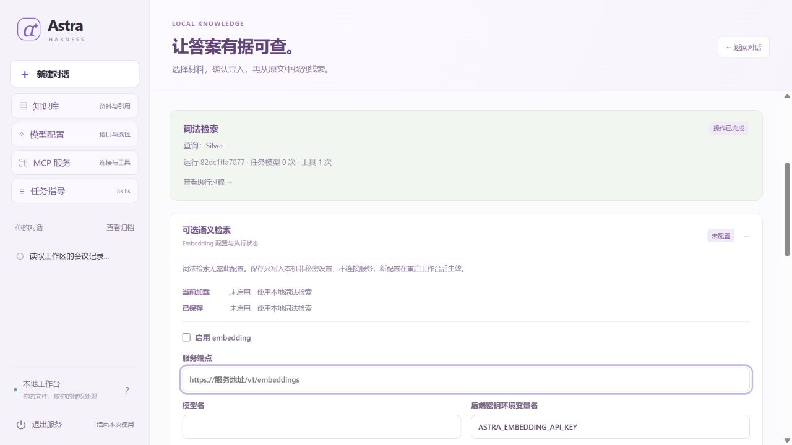

# 可选 Embedding：配置与使用

[项目首页](../README.md) · [文档地图](README.md) · [验证状态](../HANDOFF.md)

本页面向已经跑通本地知识库、希望自行接入向量服务的使用者。首次运行项目请先完成 [新手入门](GETTING_STARTED.md)；仅需要按词查找原文时，继续使用 [本地词法检索](KNOWLEDGE.md) 即可。

Embedding 把文本转换为数值向量，用于相似度检索。Astra 的可选路径复用知识材料、来源核验、工具执行器与审批，**默认关闭**。向量保存在本地 SQLite，检索在有界片段集上计算余弦相似度；项目不会下载模型权重或自动选择供应商。

**阅读路线：** [离线示例](#先跑不需要密钥的示例) → [独立配置](#把-embedding-与对话模型分开配置) → [页面操作](#在知识库页面操作) → [数据外传范围](#哪些操作会发送文本)。实现自定义 provider 时再读 [适配器接口](#接入自己的-embedding-适配器)。

本地示例用于核对模拟服务的接口、数值排序、来源与失败处理。真实模型的语义检索质量和具体服务兼容性需要分别验证，方法见 [评测说明](EVALUATION.md)。

## 先跑不需要密钥的示例

完成 [新手教程](GETTING_STARTED.md) 的依赖准备后，在源码根目录运行：

```powershell
.\.venv\Scripts\python.exe -X utf8 -m examples.embedding_demo
```

示例只创建合成材料，启动并清理自己的回环模拟服务；不读取 `.env`、不使用真实密钥、不连接外部供应商。默认清理临时目录；要保留结果，指定一个尚不存在的目录：

```powershell
.\.venv\Scripts\python.exe -X utf8 -m examples.embedding_demo --output-dir .local/embedding-example
Get-Content -LiteralPath .local/embedding-example/summary.json -Encoding UTF8
Get-Content -LiteralPath .local/embedding-example/answer.json -Encoding UTF8
Get-Content -LiteralPath .local/embedding-example/sent-inputs.json -Encoding UTF8
Get-Content -LiteralPath .local/embedding-example/trace.json -Encoding UTF8
```

重复目录会被拒绝，不覆盖已有内容。`examples` 属于源码和 sdist，不是 wheel 安装后的示例命令。

示例先拒绝一次连接测试，确认没有 HTTP 请求；随后批准固定文本测试、导入两份材料、重建向量并查询，关闭重开后再查询。最后改变原文，确认旧索引查询在请求供应商前被拒绝。

| 需要核对的字段 | 预期 | 含义 |
| --- | --- | --- |
| `task_model_calls` | `0` | 没有调用负责对话／规划的任务 LLM |
| `mock_http_requests` | `4` | 固定文本测试、一次重建、首次查询、重开后查询各一次 |
| `real_provider_requests` | `0` | HTTP 只到自建回环模拟服务 |
| `nearest_path` | `alpha.md` | 按人工向量表计算出的最近片段 |
| `stale_query_request_count` | `0` | 原文变化后没有发送新的查询向量请求 |

[示例源码](../examples/embedding_demo.py) 明确写出人工向量：甲材料 `[1,0,0]`、乙材料 `[0,1,0]`、查询 `[0.9,0.1,0]`。预期分数独立计算为 `0.9 / sqrt(0.82)`；答案还核对实际原始字节 SHA、Unicode 切片和行列。这是可复现的协议与排序例子，**不是模型理解了查询，也不是检索质量成绩**。

## 把 Embedding 与对话模型分开配置

每个知识集合可以有一个可选的 `embedding` 对象。它保存连接用途和环境变量名，不能保存密钥。可从 [非秘密模板](../embedding.example.json) 开始；该文件只是一份 `embedding` 对象，应放到已配置 `knowledge.json` 的某个 `collections` 条目中，不能直接传给 `--config` 或当作完整知识集合配置。

| 字段 | 默认值 | 怎么填写 |
| --- | --- | --- |
| `enabled` | `false` | 明确启用才装配可选向量工具 |
| `endpoint` | 空字符串 | 用户信任的完整 Embeddings 地址，路径以 `embeddings` 结尾；不是聊天接口或仅服务根地址 |
| `model` | 空字符串 | 供应商提供的确切 Embedding 模型名；启用时必填 |
| `key_env` | `ASTRA_EMBEDDING_API_KEY` | 密钥所在的进程环境变量名称；这里填名称，不填密钥 |
| `dimensions` | `null` | 不指定时不发送该参数，由有效响应确定维度；显式指定可用 `1..4096`，仍须供应商支持 |
| `revision` | `"1"` | 主机声明的配置／实现版本；改变模型行为时更新，不能当作供应商二进制证明 |
| `timeout` | `10` | 单次 HTTP 请求总等待秒数，必须大于 0、最多 60 |

例如集合条目保留原 `id`、`label`、`path`、`index`，再加入模板的 `embedding` 对象。材料目录与索引仍遵守 [知识库配置](KNOWLEDGE.md) 的限制。没有 `embedding` 字段与 `enabled: false` 都保持原词法入口。

任务模型的启动兼容入口使用 `ASTRA_API_KEY`、`ASTRA_MODEL`、`ASTRA_BASE_URL`；新 [模型档案](MODEL_PROFILES.md) 还可引用独立 `ASTRA_MODEL_..._API_KEY` 进程变量。Embedding 使用独立的 `ASTRA_EMBEDDING_API_KEY`，或角色名称如 `ASTRA_EMBEDDING_NOTES_API_KEY`。后者只接受 `ASTRA_EMBEDDING_..._API_KEY` 形式的大写名称，不能借用 `ASTRA_API_KEY`。两类角色可以属于不同供应商、模型和费用账户，不会自动互相回退；选择任务模型不改变 embedding 配置。

**不要把 Embedding 变量直接追加到现有模型 `.env` 文件。** 当前 `--env-file` 只接受上述三个任务模型变量。请在启动服务的同一个 PowerShell 终端设置进程环境，让服务子进程继承：

```powershell
$embeddingSecret = Read-Host "输入你自己的 Embedding API key" -AsSecureString
$embeddingCredential = [System.Management.Automation.PSCredential]::new("embedding", $embeddingSecret)
$env:ASTRA_EMBEDDING_API_KEY = $embeddingCredential.GetNetworkCredential().Password
Remove-Variable embeddingCredential, embeddingSecret
```

这段命令由用户自己输入密钥，不把密钥字面量写进命令历史，也不创建持久凭据文件。密钥仍存在于本机进程环境和后端内存中；移除临时变量不等于安全擦除。若配置用了角色专用名称，请同步更换赋值目标。然后从这个终端运行原来的 `serve --knowledge-config ...` 命令。已经启动的服务不会读到后来修改的终端环境，需先正常停止再启动。

结束使用并停止服务后，可以清除当前终端变量：

```powershell
Remove-Item Env:\ASTRA_EMBEDDING_API_KEY -ErrorAction SilentlyContinue
```

页面只保存变量名和显示是否存在，不能粘贴密钥；“已设置”不等于认证通过。不要把密钥放进 endpoint、模型名、材料或查询文本。

## 配置保存与运行状态

只有通过 `--knowledge-config` 明确指定的知识配置文件支持保存非秘密设置；旧 `--knowledge-index` 单库入口没有可编辑配置文件。保存校验结构并比较配置文件摘要，成功后写回同一个 JSON；它不会测试连接、激活供应商或修改当前已加载工具。

接口分别返回 `active`（本进程已加载）和 `saved`（磁盘已保存），以 `restart_required` 表示是否需要重启。存在待生效配置时，新向量操作会被拒绝；原运行仍保留原对象与审批绑定。正常停止并用同一知识配置重启后，新设置才生效。不要手工修改数据库或绕过旧运行的快照检查。

页面使用 `GET /api/knowledge/{id}/embedding-config` 取得配置和 `config_revision`；`PUT` 提交 `embedding` 与 `expected_revision`。文件已被其他操作改变时返回 409，需重新读取并核对，不能用旧页面覆盖别人刚保存的内容。

## 在知识库页面操作

先按 [双集合工作台教程](KNOWLEDGE.md#两步准备并启动双集合工作台) 准备合成材料和 `knowledge.json`，并从设置好进程环境的终端启动服务。0.5.0 也支持在 [网页中创建集合](KNOWLEDGE.md#网页创建与上传)，其非秘密配置由宿主管理；Embedding 密钥仍从后端环境读取，保存后仍需重启。以下动作只影响当前选中的集合：

1. 打开 **知识库**，展开 **可选语义检索 / Embedding 配置与执行状态**。填写启用开关、服务端点、模型名、后端密钥环境变量名，以及需要时的输出维数、配置版本标识和请求超时。表单不能填写密钥正文。
2. 点击 **保存非秘密配置**，核对 **当前加载** 与 **已保存** 两行。提示待重启时，先收尾旧运行，正常停止服务，再从同一终端用原命令重启；保存不会热切换供应商。发生保存冲突时，先用 **重新读取配置** 读取最新值，核对后再提交，不自动覆盖。
3. 点击 **刷新语义状态** 查看当前已加载配置与密钥是否存在。需要验证端点时点 **测试连接**；核对显示的 endpoint、模型及费用提醒，再在原操作卡选择 **批准并执行**、**拒绝** 或 **取消运行**。拒绝时不会发送请求。
4. 仍按原知识流程查看材料并批准词法导入／更新。然后点击 **重建语义索引**，核对语料摘要、片段数与预计请求数，再批准。只有固定测试通过并不表示材料已经有向量索引。
5. 在检索方式中选择 **语义检索 · 需审批并可能计费**，输入查询并提交。再次核对将发送的查询和当前配置，批准后查看真实片段与引用；原来的 **词法检索 · 本地执行** 仍独立可选。

状态与结果分别展示任务模型计数、Embedding 请求和供应商已报告 usage。不要把请求估计看成实付金额，也不要把未报告 usage 当作零。

## 哪些操作会发送文本

| 操作 | 发送内容 | 审批与请求 |
| --- | --- | --- |
| 状态检查／配置读取保存 | 无 | 不连接供应商 |
| 原词法导入、搜索、移除 | 无 | 保留原本地行为和写入审批 |
| `embedding_test` | 固定短句 `Astra embedding connection test.` | 需要审批，通常一次请求，不发送材料 |
| `embedding_rebuild` | 已导入并核验的材料片段 | 需要审批，最多 128 片段，每批最多 8 条 |
| `semantic_search` | 本次查询文本 | 需要审批；已有兼容向量时查询通常一次，不重发材料正文 |

具名集合使用 `knowledge.<集合 ID>.<动作>`；旧单库使用 `knowledge.<动作>`。三个可能访问供应商的工具都需要集合的 `.external` 权限以及文件／知识读取权限，重建另需 `.write`。它们统一经 ToolRegistry、ToolExecutor、审批与运行预算，不由模型自行授权，也没有第二套 Agent 循环。

**任务 LLM 的模型计数为零，不代表 Embedding 没有请求或费用。** 连接测试、文档向量化与查询向量化都可能按供应商规则收费；页面的请求估计不是人民币金额上限，原任务调用预算也不是费用硬上限。供应商未返回 usage 时保留缺失，不推断免费。实际费用以所选服务的计费记录为准。

重建绑定当前语料摘要 `expected_corpus_sha256`。全部批次成功并再次核验来源后，才在一个事务中替换数值索引；失败或取消不先删除旧向量。已发送请求仍可能收费。空语料重建不请求 API，只清理本地派生数值；即使没有密钥，也仍须启用配置并经过权限和审批。

## 来源变化、重建与删除

向量放在独立 sidecar，默认文件名为词法索引路径加 `.vectors.sqlite3`，不与原材料或运行数据库混用。它保存数值、片段身份和索引元数据，不复制材料正文；向量也可能包含材料信息，不能因此认为它是公开数据或已经匿名化。

材料变化时，应先按原知识库流程检查并批准更新词法索引，再明确重建向量。语料导入／更新／移除，或 endpoint、模型、维度、revision 等配置变化，会要求重新核对和重建，不能混用旧向量；更换密钥会使旧审批身份失效，但不会单独使兼容向量失效。

语义查询在发请求前和返回引用前都核验当前来源与片段。索引不兼容时返回 `embedding_rebuild_required`，**不会悄悄改成词法查询**。引用继续保留原始字节 SHA、从 0 开始且末端不包含的 Unicode 偏移、从 1 开始的行列，以及原文片段；另有 `score` 表示余弦相似度。分数不是答案正确率，不保证最高分内容能回答问题。

词法移除仍只删除本地该路径的索引，不删除源文件，也不触发供应商请求。旧 sidecar 数值随语料变化而逻辑失效，直到用户明确重建才替换或清空；这不是磁盘安全擦除承诺。查询最多返回 5 个命中、合计 4,000 个文本字符，现有上下文预算仍然生效。

## 错误、取消与连接边界

- `not_configured`：尚未启用；`missing_key`：后端启动时未取得有效密钥；`not_built`：还没有向量索引。状态读取不会为了判断可用性偷偷发请求。
- `rebuild_required`：来源或配置不兼容，先检查材料与当前配置。`embedding_busy` 表示同一索引已有操作，不要靠连续点击启动另一份重建。
- 认证失败、限流、超时、错误模型或错误维度使用固定错误码。运行 `completed` 也要检查实际 `tool_result.error_code` 和 `value.ok`；业务拒绝不等于成功。
- 请求已经开始发送后，断流、协议错误、超时或取消不能证明未收费；结果可能进入 `unknown` 并触发全局核查门禁。不会自动重试、重建新任务或退款。按 [安全边界](../SECURITY.md) 核查原进程和供应商／本地产物；停止本地等待不保证服务端取消。

endpoint 必须由用户明确信任并配置：HTTPS 支持域名或公开 IP；HTTP 仅支持数字回环 `127.0.0.1`／`[::1]` 和显式端口。拒绝 URL 内凭据、查询、片段、百分号编码和不明确路径；不接受已识别的内网 IP。HTTPS 域名不做 DNS 固定，**不是通用 SSRF 防护或网络沙箱**。

内建适配器每次调用独立创建和关闭 HTTPX 客户端，校验 TLS，禁用环境代理、重定向、Cookie 与自动重试；每批最多 8 条，每条最多 1,000 个字符，原始响应最多 4 MiB，响应头检查上限 16 KiB，拒绝压缩。返回模型名必须与配置精确相同，不自动兼容供应商别名；维度必须一致，拒绝非有限数和零向量。没有供应商 SDK、重排模型或所有厂商兼容保证。

## 接入自己的 Embedding 适配器

`EmbeddingProvider` 是很小的接口：持有 `config`，提供 `status()`、不透明的 `recovery_identity()`，以及异步 `embed(texts) -> EmbeddingBatch`。在宿主装配时把适配器注入 `SemanticKnowledgePlugin(knowledge, provider, config)`；无需修改 Engine 或 ToolRegistry。

下面是纯内存的教学适配器，只识别人工写出的两个输入，不是可用来检索真实材料的模型：

```python
import hashlib
from astra_harness.builtin.embeddings import EmbeddingBatch, EmbeddingError

class TableEmbeddingProvider:
    def __init__(self, config):
        self.config = config
        self._vectors = {"synthetic alpha": (1.0, 0.0),
                         "synthetic beta": (0.0, 1.0)}

    def status(self):
        return {"state": "ready", "key_present": False}

    def recovery_identity(self):
        # Fixture identity only; there is no credential in this adapter.
        return hashlib.sha256(("table-fixture-v1:" + self.config.identity()).encode()).hexdigest()

    async def embed(self, texts):
        if not texts or len(texts) > 8 or any(text not in self._vectors for text in texts):
            raise EmbeddingError("embedding_invalid_input", request_issued=False)
        return EmbeddingBatch(tuple(self._vectors[text] for text in texts), self.config.model, None)
```

这展示了接口形状；完整注册与审批装配见 [本地示例](../examples/embedding_demo.py)，人工向量适配器与失败边界见 [回归用例](../tests/test_semantic.py)。适配器是受信任宿主代码：真实实现必须如实声明发送是否开始、取消行为、身份变化和用量缺失，不能把异常全部伪装成“没有请求”。凭据轮换应改变审批恢复身份；不要把密钥或可独立使用的凭据摘要写进配置、输出或日志。内建配置摘要也不是模型实现与远端行为的密码学证明。

## 工作台配置入口



[窄屏配置入口](images/embedding-mobile-current.jpg) 与桌面图均显示默认未配置状态，使用者可在此填写自己的服务配置。本次截图没有执行向量生成或语义查询，不展示已验证的相似度、排序或真实服务效果。

下一步：回到 [知识库指南](KNOWLEDGE.md) 管理材料，或阅读 [扩展指南](EXTENDING.md) 了解 provider 与统一工具运行时的边界。
