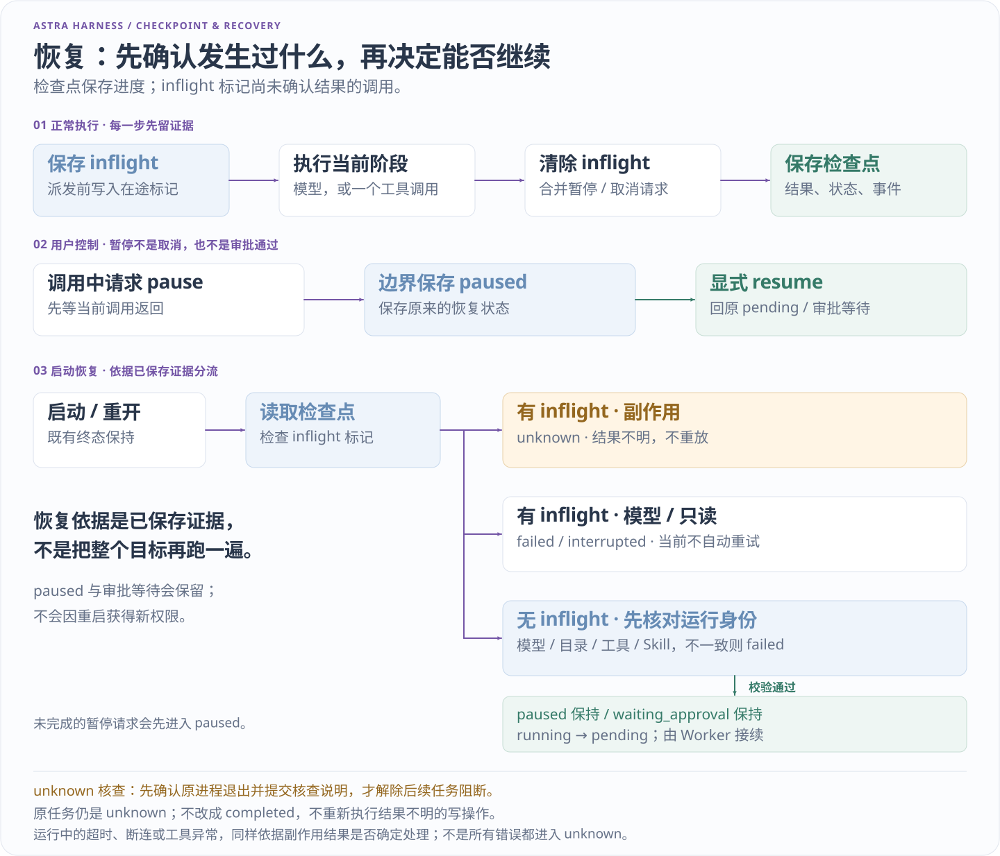

# 评测与实验复现

[项目首页](../README.md) · [文档地图](README.md) · [当前交接](../HANDOFF.md)

本项目把两个问题分开验证：运行时是否遵守执行规则，以及模型能否完成任务。确定性模型可以稳定制造边界条件；真实模型结果需要绑定模型、数据、配置和实际运行记录，不能由单元测试数量推导。

本副本提供实验源码、合成任务与判据，不附原项目的历史原始报告、私人日志或费用账本。以下场景和数量描述实验设计；实际结果以你本次生成的文件为准，不预填通过成绩。

## 先运行现有验收

在项目根目录执行，默认不连接模型供应商：

```powershell
.\.venv\Scripts\python.exe -X utf8 -m unittest discover -s tests -v
.\.venv\Scripts\python.exe -X utf8 -m astra_harness eval
.\.venv\Scripts\python.exe -X utf8 -m astra_harness benchmark
```

| 入口 | 实际检查 | 不能据此声称 |
| --- | --- | --- |
| unittest | 执行器、配置、上下文、审批、预算、取消、恢复、文件和本地协议边界 | 真实模型泛化成功率或公网安全性 |
| eval | 三份虚构会议文件、六项 JSON 待办；审批前不写、重开 Application 后批准、提交去重 | Python 进程在写入中途崩溃的完整实验 |
| benchmark | 九个独立任务；工具结果、禁止调用、状态、错误与文件产物 | 大规模任务表现、性能提升或统计显著性 |

`eval` 重开的是同一 Python 进程中的 Application，测试数据与默认个人工作区隔离。`benchmark` 为每例新建工作区和 SQLite 数据库，报告保存在命令输出的 `report` 路径。首次使用见 [入门教程](GETTING_STARTED.md)；保存每次输出，失败结果也应保留。

## 评分必须观察真实效果

[任务集](../astra_harness/datasets/smoke.jsonl) 使用可阅读的 JSONL；[评分实现](../astra_harness/benchmark.py) 独立检查实际消息中的 ToolResult 和文件内容。

- 加法同时核对 `add` 的数值结果，不能仅凭答案出现“5”通过。
- 搜索核对匹配路径、行号、原文、扫描数量和截断状态。没有匹配的用例必须实际返回空结果；找到内容的用例还要求答案给出来源文件。
- 文件任务核对 `todos.json` 的完整结构与六项预期值；待审批或拒绝审批时检查文件不存在。
- 禁止调用既检查已返回结果，也检查提出的工具调用，避免 unknown 或缺少结果掩盖尝试。

这批预期针对固定的三份会议样例。更改样例或评分规则后应重新生成基线，不能沿用旧结果。搜索失败的反例在 [test_search_scoring.py](../tests/test_search_scoring.py)：即使回答看似正确，空结果、错误行号、错误原文或未实际调用工具也应评分失败。

## 怎样比较两次运行

先保存一次基线，再传入其实际报告路径：

```powershell
.\.venv\Scripts\python.exe -X utf8 -m astra_harness benchmark --output-dir .local/benchmarks
.\.venv\Scripts\python.exe -X utf8 -m astra_harness benchmark --baseline .local/benchmarks/上次实际目录/report.json
```

第二条中的目录是占位说明，需要替换为第一条输出的实际路径。自定义预算使用 `--config astra.example.json`，两次必须使用相同配置。

schema 3 报告记录任务集指纹、运行模式、完整次数／时间／上下文预算、模型适配器和模型名，并增加规范工具清单及实现身份。比较前验证清单摘要自洽、唯一案例 ID、布尔评分和汇总；空对象、缺字段、畸形报告或已记录条件不同都会明确拒绝，不当作“没有基线”。

工具的名称、Schema 验证约束、权限、副作用／审批策略、实现版本、函数／声明依赖和常量参与身份。工具顺序与集合顺序被规范化，纯说明文字另行记录。若只改变 description/title，比较仍允许，但 metadata_changed/notes 会说明工具提示发生变化；真实模型可能因此改变选择，不能把它描述为完全相同的模型输入。完整规则见 [评测工具身份](ARCHITECTURE.md#评测工具身份)。

结构、任务条件与工具身份预检在模型构造、评测目录创建和任务执行前完成。模型 adapter/name 需构造首个适配器后核对，但不会先请求供应商。每次实际绑定工具和构造后续模型也会复核身份；运行开始后发生的工厂漂移会停止，已产生的证据不删除。自定义工具／模型工厂是可信主机代码，不受操作系统沙箱约束，工厂自身应避免副作用。

比较结果包括逐例退步／改善、通过率差值和平均耗时差值；耗时只作描述，不设依赖本机负载的通过门槛。[基线回归](../tests/test_benchmark_baselines.py) 保留既有任务集、模式、预算、模型与评分校验，工具身份并不替代这些条件。

旧 schema 2 文件可以继续读取并查看原结果，但缺失当时工具身份，不能用于新比较。迁移方式是在当前明确配置下重新运行生成 schema 3 基线，保留旧报告及其历史适用范围；**不要复制当前指纹进旧报告或手工只改 schema_version**，那会伪造当时并未记录的条件。

模型身份仍只比较 adapter/name，**没有覆盖同名模型的不同端点、权重更新、样例内容字节身份、未声明依赖或完整主机环境**。工具实现摘要不是全部源码、操作系统和外部服务的证明。这里比较的是已记录条件；新的源文件版本也不一定等于新工具行为，规范化规则与声明范围需要一并解释。

两个工具摘要都做顺序规范化，不是完整模型输入的逐字散列：仅改变工具或 enum 等顺序时，metadata_changed 可能仍为 false；允许比较不表示提示字节相同。

逐例 duration_ms 仍记录任务执行及模型构造耗时；工具身份预检、工作区绑定后的身份复核和报告写出不在此计时内，不能把该字段解释为评测命令总耗时。

### 离线验证比较准入

```powershell
.\.venv\Scripts\python.exe -X utf8 -m scripts.tool_identity_lab
```

[实验驱动](../scripts/tool_identity_lab.py) 生成一个工具任务基线，再运行相同条件与允许的规范化／说明变更；用工具工厂变体验证不兼容定义在任务启动前被拒绝。旧 schema 2 样例由本次基线派生，记录来源，不冒充历史报告。逐例记录模型构造、模型请求、handler 调用与输出目录是否创建，用于核对准入行为，不是算法效果提升或模型成功率实验。

本实验设定 12 个准入案例，其中 3 个应允许比较、9 个应在执行前拒绝。运行后逐项核对判据和调用记录；前置拒绝不能计作任务完成，报告正常生成也不能代替检查实际断言。

## 当前恢复语义

下面表示当前实现的恢复决策；完整字段与接口见 [架构](ARCHITECTURE.md#持久化与恢复)。



`resume` 继续原运行的已保存位置；重新提交是新运行；网页事件回放只展示已有事件。CLI `inspect` 不推进待执行模型，但会构建 Application 并执行启动恢复，也可能按配置启动 MCP，因此不是磁盘层面的完全只读命令。

既有单元测试中的部分恢复状态通过人工保存 inflight 标记模拟，进程门禁测试验证了 unknown 原进程的存活／退出。这些测试继续保留；下面的故障驱动另用真实进程退出验证具体窗口，两类证据分别记录。

## 真实进程故障实验

从源码项目根目录执行，不需要模型密钥或额外依赖：

```powershell
.\.venv\Scripts\python.exe -X utf8 -m scripts.recovery_lab
```

这是开发与实验入口，不是已发布 wheel 的命令。默认在 `.local/recovery-lab/` 下创建新的 suite 目录；输出的 `directory`、`report` 和 `summary_report` 分别定位目录、`report.json` 与 `summary.md`。JSON 保存逐项证据，Markdown 摘要便于对照场景、状态和计数。每例保留独立 SQLite、`ledger.jsonl`、故障前检查点和恢复记录，不使用个人工作区。

[驱动源码](../scripts/recovery_lab.py) 使用固定模型、真实本地追加工具和读取工具。写入以独立 JSONL 账本记录 run／call／step，并执行 flush、fsync；重复执行会留下重复记录。账本独立观察实际追加次数、参数和阶段，call_id 则取自持久 inflight 标记，不能据此宣称验证了任意并发调度器的身份生成。模型调用与读取也有审计，不能只靠最终回答推测是否重新调用。读取场景检查业务输入未变化；夹具的审计写入不等于业务工具有写权限。

矩阵设定 11 个实际异常退出窗口和 1 个只读回放场景。握手确认模型、工具或 Store.save 的目标位置后，子进程执行 `os._exit(73)`，不经过 Application.close 的正常收尾。父进程有超时并只清理自己创建的子进程，没有按名称终止其他服务。所有注入留在实验驱动，生产内核没有增加故障开关。

Windows 虚拟环境可能先启动一个解释器转发进程，因此工作进程 PID 不必等于 `Popen.pid`。当前驱动通过自己持有的标准输入／输出管道确认边界、运行 ID 与检查点身份，分别记录工作进程 `pid`、`launcher_pid`，并将退出码来源标为 `owned_popen`。随后发出 crash 确认、等待该自有进程句柄返回 73，再检查落盘效果；不会依据信号中的 PID 查找或终止其他进程。旧报告保留当时字段，不回填成新的执行证据。

### 场景与验收预期

下表是独立写明的验收预期，不是已执行结果。十二个场景覆盖安全检查点、审批、多工具批次、在途调用和预算继承；最终结论应逐项对照生成报告。

| 案例 ID | 注入点或操作 | 预期终态 | 必须核对的效果 |
| --- | --- | --- | --- |
| safe-boundary | 模型结果已落盘，工具 inflight 尚未保存时退出 | completed | 原调用继续，累计写入 1 次，原预算保留 |
| inflight-before-handler | 工具 inflight 已提交，处理函数尚未进入时退出 | unknown | 实际写入 0 次；不凭“可能没执行”自动重试 |
| effect-before-checkpoint | 写入已 fsync、工具已返回，结果检查点尚未保存时退出 | unknown | 实际写入保留 1 次，不重新执行 |
| waiting-approval | 待审批检查点提交后退出 | completed | 原审批保留；批准前 0 次写入，批准后 1 次 |
| changed-arguments | 已批准但未执行时退出，在隔离实验库中改变参数 | completed | 旧摘要不能批准新参数；新审批后只写新值 1 次 |
| trace-read-only | 完成后重复分页读取已保存事件 | completed | 事件、检查点与调用账本不变，不构造 Application |
| batch-safe-boundary | 同批第一个工具的结果已保存，第二个工具 inflight 尚未保存时退出 | completed | 保留第一条结果，只执行第二个工具；两条不同写入各 1 次 |
| batch-effect-before-checkpoint | 同批第二个工具已完成写入，第二条结果检查点尚未保存时退出 | unknown | 账本已有 2 次不同写入；仅第一条结果落盘，恢复不重复任何工具 |
| model-inflight | 固定模型已进入 complete 并记录调用，返回结果前退出 | failed / interrupted | 模型实际调用共 1 次，恢复不重发请求，保留已发起计数 |
| read-inflight | 真实读取固定输入并记录审计后、返回结果前退出 | failed / interrupted | 业务输入不变，实际读取共 1 次，恢复不重复读取 |
| model-budget-exhausted | 原模型次数预算为 1；模型与工具结果自然保存后，在下一模型阶段前退出 | failed / model_limit | 恢复主机即使提供 99 次默认额度，原运行仍是 1 次预算；无额外调用或写入 |
| time-budget-exhausted | 夹具推进内核所见单调时钟，内核累计耗时后在工具安全边界退出 | failed / run_timeout | 原 30 秒预算已耗尽；恢复主机的 300 秒默认值不生效，工具不执行 |

生成报告后分别查看安全检查、completed、unknown 和 failed 的计数，再核对退出码、调用记录与独立账本。不能将符合预期的 unknown 或 failed 合并为任务完成，也不能把这组固定窗口的结果写成通用恢复成功率。

参数变更是实验驱动对私有检查点的故障注入，不是产品提供的编辑审批接口，也不能据此宣称能抵御恶意数据库操作者。模型和只读工具中断当前都保守标记 failed，不自动重试；调用者可以明确发起新任务，但当前没有自动重试策略。未知写入也不因“只差保存结果”而重放。

`tool.end` 事件可能先于结果检查点落盘。单次和批次写入窗口都要求核对这一区别：事件已出现，磁盘检查点仍带 inflight，恢复就必须保留 unknown。工具结束事件不是副作用结果已完整提交的证明。

### 如何阅读指标与计时

| 字段或证据 | 如何解释 |
| --- | --- |
| `passed` / `task_completed` | 安全语义符合预期与实际任务完成分别统计；正确保留 unknown 或 failed 不能计作任务成功 |
| `summary.by_status` | 分别查看 completed、unknown、failed，避免只展示一个通过率 |
| `recovery_calls` | 从独立审计核对重启后的新增调用；续跑剩余工具可以是正确行为，未知场景应无新增调用 |
| `duplicate_effects` | 按账本检查相同操作是否重复；批次有 2 个不同写入不等于重复副作用 |
| 检查点、事件与账本 | 三者交叉核对阶段、调用配对、审批、预算和真实效果，不只读取报告中的 passed |
| `duration_ms` | 用实际 `perf_counter` 测得，包含进程启动与驱动开销；不是供应商延迟或性能提升 |
| 解释器、平台与源码散列 | 标识本次夹具和实现条件；不能据此推定其他环境结果相同 |

时间预算场景明确标记 `clock_mode="injected_monotonic"`。它只在夹具子进程中替换 Engine 所见的单调时钟：模型阶段完成后推进 31 秒，由 Engine 自己计算累计 `elapsed`，而非直接修改检查点中的耗时字段。它没有真实等待 31 秒；报告的 `duration_ms` 仍使用独立真实时钟。该场景验证的是“已耗尽的原预算不会在重启后重置”，不用于速度比较。

现有预算在阶段入口和调用等待处检查。最终回答形成终态后，观察者或落盘开销可能使累计 `elapsed` 超过配置值，系统不会仅因此逆转终态；这不是硬实时完成期限。暂停、审批和进程离线时间也不等于累计执行时间。分析结果时，应同时看原预算、累计执行耗时、实际运行耗时及最终状态。

[独立回归](../tests/test_recovery_lab.py) 同时读取原始 SQLite 和账本，核对实际副作用、调用配对与审批。`read_trace` 使用 SQLite 的 mode=ro／query_only 读取，不运行恢复或业务调用；SQLite 在可写目录可能管理 WAL 辅助文件，因此不承诺任何环境下绝对没有文件系统活动。

当前矩阵仅覆盖这些握手控制的本地进程窗口。原始检查点、事件和账本保存在本次 suite 中；没有注入的网络、磁盘或断电故障不在结果范围内。

## 任务级恢复策略对照

十二场景矩阵验证明确窗口中的恢复规则。本节进一步问：在有独立产物判据的文件任务中，从检查点继续与重新提交整个任务，各自留下什么结果、重复了什么工作，以及需要怎样的人工核查？

本实验将文件产物正确性与运行终态分别记录，再比较策略的重复工作和核查需求。下面给出设计与判据，不预设哪种策略必然更优。

### 任务与业务效果

使用三个固定的虚构本地任务，每项有两次业务写入。输出预期由独立检查规则给出，不能用模型自评、脚本正常退出或驱动的 `passed` 代替。

| 任务 | 处理流程与产物 | 重复执行时需要观察什么 |
| --- | --- | --- |
| 材料摘录 `materials` | 读取两份 Markdown，生成 `digest.json` 和 `report.md`；保留四条材料的来源路径、行号与原文 | 两项产物均采用原子覆盖；相同内容再次写入可能仍得到正确结果，但工具调用会重复 |
| CSV 整理 `csv-normalization` | 读取 CSV，去除多余空格、规范名称并合并同人／同组工时，生成 `normalized.json` 与 `totals.json`；独立预期为三人各 3、3、4 小时，总计 10 小时 | 核对规范化记录和分组汇总；原子覆盖可以保持产物正确，不等于没有重复执行 |
| 受控配置更新 `config-change` | 从固定原配置与补丁生成 `output/config.json`，将 workers 从 2 改为 4、logging 从 info 改为 debug，保留其他字段；向 `output/history.jsonl` 追加一条变更 | 配置最终值正确还不够；固定 `change_id=tune-demo-v1` 的业务变更应恰好一条，重复追加必须在业务记录指标中体现 |

固定模型计划先取得真实输入 ToolResult，再计算两次业务写入，执行后通过工具读回两个输出并验证，最后结束。它不是语言模型自主推理能力的测试。第三项的历史是任务要求的产物，和实验用于审计调用的账本分开。审计中多一条调用，不必然意味着业务数据多一条；反过来，配置值正确也不能掩盖历史中重复的变更记录。

### 条件、策略与配对

| 条件 ID | 操作窗口 | 需要回答的问题 |
| --- | --- | --- |
| `normal` | 按固定计划完成，不注入退出 | 两种策略的正常路径是否满足同一产物判据？ |
| `safe-after-first-write` | 第一项业务写入及其结果检查点已保存，第二项尚未执行时退出 | 能否只继续剩余步骤？完整重跑又会重复哪些调用？ |
| `effect-before-checkpoint` | 最后一项业务效果已实际完成，结果检查点尚未保存时退出 | 如何区分文件看起来正确、运行已完成和副作用仍需核查？ |

故障条件使用真实测试子进程退出，不通过手工改写终态或产物制造结论。该驱动不注入时间偏移；它只选取三个代表条件，不覆盖三个任务与十二种故障窗口的完整笛卡尔组合。

| 策略 | 故障后的操作 | 必须保留的比较边界 |
| --- | --- | --- |
| `checkpoint_resume` | 使用原数据库和运行检查点，按正式恢复规则继续或保留 unknown | 继承原计数与剩余预算；unknown 不自动重放、不自动记为完成 |
| `naive_rerun` | 保留工作区和旧运行证据，另建数据库，重新提交相同固定计划，不增加去重机制 | 这是新任务，获得新的预算；重复覆盖和重复追加都如实记录 |

配对两侧各有独立工作区，使用相同的初始样例、固定模型／计划、初始预算、权限与故障条件。`normal` 条件下两策略都只执行一次，不对已完成任务额外重跑。故障后，`naive_rerun` 只创建一次新数据库／运行，不重新播种输入；原工作区中的已发生业务效果保留，旧数据库也不被删除或改写为成功。两种策略在隔离实验数据上运行，不成为正式应用中可绕过 unknown 的开关。

由于 `naive_rerun` 同时改变运行身份、重启位置并获得新任务预算，这里是**恢复策略对照，不是严格的单机制消融**。不能把观察到的差异全部归因于某一个检查点字段或去重机制。

默认设计为 `3 个任务 × 3 个条件 × 2 个策略 × 3 次重复 = 54 次策略试验`。按同一任务、条件和重复编号配成 **27 对**，独立任务仍只有 **3 个**。每个“任务 × 条件 × 策略”组合有 3 次观测；54 不能当作 54 个不同任务的泛化测试样本。

### 指标与判定

| 指标 | 读取依据与解释 |
| --- | --- |
| `artifact_correct` | 对实际文件内容应用独立预期，区分内容正确和脚本执行结束 |
| `run_status` / `runtime_completed` | 原样记录终态，以及是否为 completed；completed 本身不证明产物正确 |
| `task_success` | 同时要求 runtime_completed 与独立 artifact_correct；不能由任一项单独替代 |
| `readback_verified` | 固定模型计划是否取得真实读回结果并确认一致，另行记录，不替代独立产物评分 |
| `needs_review` | 最终 unknown 或原运行遗留副作用在途窗口均需核查；新任务完成不会解除旧操作的不确定性 |
| `duplicate_business_records` | 从真实业务历史判断同一逻辑变更是否重复；不从审计行数直接推算 |
| `repeated_effect_calls` | 记录同一逻辑写入步骤是否被再次执行；幂等覆盖重复也要计数 |
| `attempt_count` / `attempts` | 前者是原运行与重新提交的尝试次数，后者保留每次尝试的明细；新任务不是原运行继续 |
| 初始与恢复阶段调用数 | 分列各阶段实际模型、读取和业务写入调用，不能只看最后一个数据库中的计数 |
| 真实耗时 | 保留逐次值，并按相同任务／条件／策略给出最小值、中位数、最大值；包含子进程、恢复和证据检查开销 |

若最终写入已发生但结果未保存，检查点策略可能得到 `artifact_correct=true`、终态 unknown。两项都必须保留：产物核对不抹去执行的不确定性，unknown 也不能被计作任务完成。人工检查后的后续处理不在该实验的自动恢复策略中。

简单重跑策略不会先重开原数据库，以免预先执行一次正式恢复而混淆策略。旧检查点保留真实退出时的 running／inflight；`initial_inflight_unknown` 标记原副作用在途窗口。`unknown` 统计的是最终运行状态，`needs_review` 还保留原操作核查需求，因此不能用新任务的 completed 替代旧证据。

完整重跑在前两种幂等覆盖任务中，可能保持产物正确且没有重复业务记录；这属于应被保留的合理结果。它仍可能增加调用与尝试次数。追加历史任务则单独检查是否重复记录同一逻辑变更。协议不预设某策略在所有维度优于另一策略。

unknown 提前停止产生的较少调用或较短耗时，不能解释为完成同一任务更高效。耗时按相同任务／条件／策略描述，比较时同时保留产物与终态；该实验不进行配对显著性检验或跨任务平均速度排名。

驱动正常结束或安全断言通过，只表明实验流程按预期执行；不能替代具体任务的产物与终态判定。报告必须同时呈现正确内容、未确认完成和重复效果，不能只选其中一个数作为“成功率”。

### 复现与结果状态

从源码项目根目录运行：

```powershell
.\.venv\Scripts\python.exe -X utf8 -m scripts.task_recovery_lab --repetitions 3
```

这是使用虚构本地数据的开发实验，不请求模型供应商，不读取个人工作区。默认在 `.local/task-recovery/` 创建新 suite；`report.json` 的 `rows` 保存逐次记录，`rows.csv` 便于逐行分析，`summary.md` 展示汇总。输出中的 `csv_report` 和 `summary_report` 可定位后两者。

原始 CSV 每行对应一个任务、条件、策略和重复编号；使用同一组标识在 JSON 中追溯输入条件、原始证据与评分。`aggregates` 按任务／条件／策略汇总，每组默认有 3 次记录，并给出实际耗时的最小值／中位数／最大值。源码和输入样例指纹分别保存；应保留所有重复与失败，不能只导出表现最好的一次。

运行结束后，对照 `report.json`、`rows.csv` 和 `summary.md` 核对记录是否齐全、每个配对是否具有相同任务与条件，并保留所有失败和 unknown。图表应从这些实际记录生成；不能将预期计数或另一版本的旧数据填入本次结果。

三次重复主要用于暴露固定场景下的执行波动与保留逐次证据，不足以建立通用统计显著性。这里不包含真实供应商随机行为、网络不确定性、断电、磁盘故障、恶意并发修改或外部幂等协议。后续扩大任务种类、重复次数或机制消融时，需要重新写明实验分母与比较条件。

## 尚未执行的实验方向

现有实验驱动包含十二场景矩阵及三个文件任务的恢复策略对照。后续仍需扩大独立任务种类、改进实验条件并设计单机制对照；这些方向没有由本副本预先给出结果。

| 场景组 | 现有实验设计 | 下一步补齐 |
| --- | --- | --- |
| 应用任务覆盖 | 十二窗口矩阵与三个固定文件任务的策略对照 | 扩大独立任务种类与输入变化，不把重复次数当作任务多样性 |
| 机制消融 | 检查点继续与完整重跑会同时改变多个条件 | 另做一次只改变一个机制的隔离对照，分别比较任务完成与重复副作用 |
| 重复统计 | 默认每组重复 3 次，保存逐次值与最小／中位／最大值 | 按研究问题扩大样本与控制运行顺序；当前不支持显著性结论 |
| 环境故障 | 握手控制的本机进程异常退出 | 另设计真实网络不确定性、磁盘故障与断电场景；当前未覆盖 |
| 真实模型与外部工具 | 本地固定模型与自编服务不能覆盖真实供应商 | 按明确授权、费用与数据范围复验，不把本地夹具推广为远端事务保证 |

后续任务级实验继续记录是否到达故障窗口、预期终态、重复副作用、未审批执行、恢复新增调用、预算继承、实际耗时和轨迹完整性。应先写明分母与判定规则：安全检查通过率、任务完成率和允许恢复任务中的完成率各自回答不同问题；没有执行对应实验前不提供改善百分比或统计显著性结论。

后续消融只在虚构本地数据的实验驱动中进行，分别比较完整机制、丢弃检查点从头执行、忽略 inflight 重试、恢复重置预算、审批不绑定参数；一次只改变一个机制，不把危险策略做成日常应用开关。真实模型评测再按明确任务、费用范围和重复次数执行，保留每次原始结果，不提前填写提升百分比。

## 文件片段与上下文对照

研究问题是：同一份允许读取、但超过当前上下文容量的文件，按需取行能否在原预算内形成正确结果？从源码运行：

```powershell
.\.venv\Scripts\python.exe -X utf8 -m scripts.file_range_lab
```

[对照驱动](../scripts/file_range_lab.py) 创建一份以 ASCII 填充为主、目标字段含 UTF-8 文本的合成文件。两个独立运行使用相同工具集、权限、输入、上下文与执行限制，都先调用 files.search，从真实命中的 path/line 选择全文读取或有限片段读取。固定脚本模型从实际 ToolResult 解析四个字段及引用，独立字面量判据检查 JSON 类型与内容；模型不读取评分预期。

报告分别保存工具返回值序列化后的实际字符／UTF-8 字节数、每次调用、运行状态、上下文估计、最终 JSON 与独立正确性。源码、输入和运行条件指纹用于核对对照条件；该报告独立记录当次条件，不借用或回填其他版本的 benchmark 基线。

这是单份合成输入的一次成对功能验证，不是 LLM 规划能力评价，也不构成泛化成功率或性能统计。片段工具每次仍有界扫描至 EOF，search 也可能整读文件；返回量下降不等于磁盘 I/O、token 用量或耗时同比下降。多次片段累积后仍可能超过上下文预算。实际数值与判据应从本次生成的 `report.json` 和 `summary.md` 核对。

## 设计参考与归属

项目记录中的设计参考如下，未将这些框架作为运行依赖。现有记录声明只借鉴思路、没有复制下列项目的源码或图像；这不是对全部原创性的独立认证。

| 来源 | 借鉴的设计问题 | 本项目取舍 |
| --- | --- | --- |
| [LangGraph persistence](https://docs.langchain.com/oss/python/langgraph/persistence)，[MIT](https://github.com/langchain-ai/langgraph/blob/main/LICENSE) | 区分执行检查点和跨会话记忆 | 当前 SQLite 保存运行进度；不将它宣称为长期记忆系统 |
| [OpenAI Agents 审批流程](https://github.com/openai/openai-agents-python/blob/main/docs/human_in_the_loop.md)，[MIT](https://github.com/openai/openai-agents-python/blob/main/LICENSE) | 审批中断、状态序列化和继续 | 维持运行内调用与参数摘要绑定，不默认永久批准同名工具 |
| [mini-swe-agent](https://github.com/SWE-agent/mini-swe-agent/blob/main/README.md)，[MIT](https://github.com/SWE-agent/mini-swe-agent/blob/main/LICENSE.md) | 简单线性轨迹与 agent/model/environment 分工 | 保留可解释的小内核；Windows 文件权限仍由本项目执行器管理 |

参考链接保留已有资料来源，本次副本文档整理没有重新联网核验上游文本。Astra Harness 由所有者选择 [MIT License](../LICENSE)，这些参考项目与第三方依赖的适用声明仍独立保留。实现与文档有 AI 辅助；个人的独立修改、设计理解和实验分析应按实际完成情况记录。

## 可选适配器的本地验证

下列入口使用本机合成数据、自编服务或模型替身。它们可检查协议与执行路径，不能替代真实供应商互通、语义相关性或模型任务能力的验收。

| 验证目标 | 源码入口 | 核对内容 |
| --- | --- | --- |
| 词法检索与来源 | `python -m examples.knowledge_demo` | 审批导入、引用对应真实原文、重开索引后查询 |
| MCP 服务生命周期 | `python -m examples.mcp_services_demo` | 独立服务状态、工具注册、审批与清理 |
| 回环 HTTP MCP | `python -m examples.mcp_http_demo` | JSON／SSE、审批拒绝、写后断连 unknown 与服务清理 |
| Embedding 接入 | `python -m examples.embedding_demo` | 人工向量的维度、持久化、排序、来源变化后拒绝查询和审批前零请求 |
| 模型与 MCP 档案 | `python -m examples.model_profiles_demo`、`python -m examples.mcp_profiles_demo` | 保存不请求、显式测试、身份冻结和重开规则 |
| Skill 与工作区 | `python -m examples.skills_demo`、`python -m examples.workspace_demo` | 指导快照、内容更新后重新启用、目录绑定和旧任务隔离 |
| 核心文件工具 | `python -m examples.core_tools_demo` | 预期内容校验、审批、修改与恢复 |

表中 `python` 使用安装好依赖的项目解释器。各入口会新建合成运行目录；具体配置、输出和限制见相应 [能力指南](README.md#按需接入能力)。Embedding 的人工向量只验证数据流和排序实现，不是语义质量评分。

网页操作另需实际浏览器检查：桌面与窄屏、重复点击、草稿取消、迟到结果、审批拒绝、重开失败和来源过期。前端单元测试及返回成功的 HTTP 请求不能独立证明界面交互可用。

## 真实模型验收与证据边界

真实服务验收需明确输入、模型配置、费用上限和中止条件，按 [真实模型验收准备](LIVE_ACCEPTANCE.md) 单独执行。默认 CLI 的字符、次数和时间预算不是金额硬上限，旧的模型联调也不能覆盖后来新增的全部工具和配置路径。

每次结果应绑定源码与任务集、工具身份、模型与端点、预算、环境和真实执行时间，保留失败、未知计费与复测。导出前排除凭据、私人材料和请求头。本副本只提供复现方法；公开分享结果时，应附与结论相匹配的脱敏证据，而不是引用没有随附的旧成绩。
