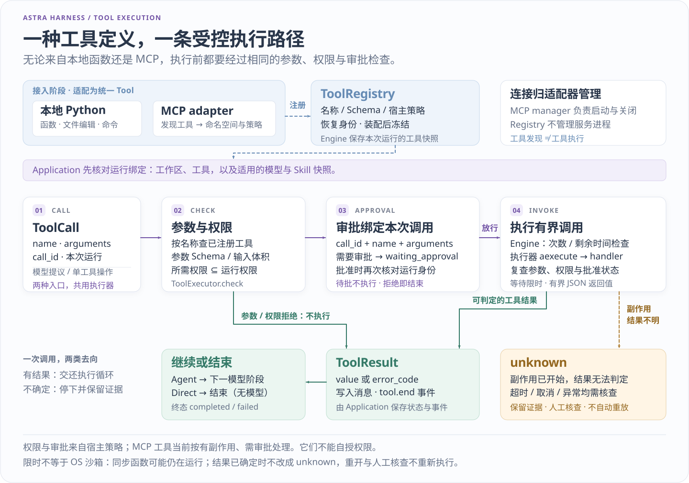
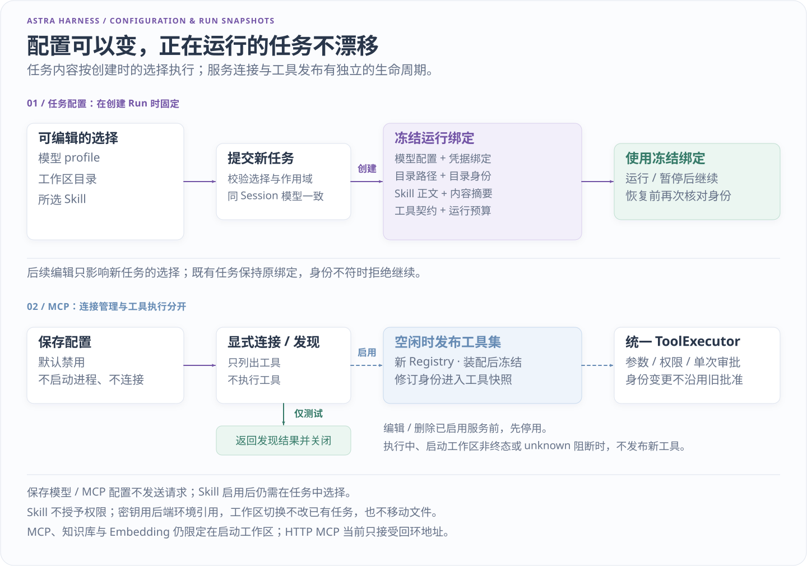

# 扩展工具与适配器

[项目首页](../README.md) · [文档地图](README.md) · [当前交接](../HANDOFF.md)

面向需要接入自定义能力的开发者。先选合适入口，再实现最小契约；模型、工具和任务指导都有现成接入点，不需要另写 Agent 循环。

只想配置现成服务时，直接使用 [模型档案](MODEL_PROFILES.md)、[MCP 服务](MCP_PROFILES.md)、[Embedding](EMBEDDING.md) 或 [本地 Skill](SKILLS.md) 指南。本文说明代码接入方式；职责全貌见 [架构](ARCHITECTURE.md)。

## 选择接入点

| 需要接入什么 | 当前契约与入口 | 宿主负责什么 |
| --- | --- | --- |
| 普通 Python 函数 | `tool_from_function(...) → Tool`；由 `Engine` 的 `ToolRegistry` 注册 | 明确权限、副作用、审批与实现版本 |
| 需要自定义参数结构的工具 | `Tool(input_schema=..., handler=...)` | 使用已支持的 Schema 子集，约束资源和返回量 |
| 带资源生命周期的一组工具 | `plugin.activate(registry)`，可返回清理函数；交给 `PluginManager` | 信任插件代码、关闭资源；注册失败时回滚注册表 |
| 任务模型 | `complete(ModelRequest) → ModelResponse`；Engine 也支持可等待结果及可选 `stream(request, on_delta)` | 供应商协议、超时、错误清理和模型配置身份 |
| Embedding 服务 | `EmbeddingProvider.status / recovery_identity / embed` | 批次、维度、使用量和索引兼容性；通过知识工具进入执行器 |
| MCP 服务 | `MCPServiceManager` 将发现结果转换成 `Tool` | 连接所有权、命名空间和清理；不在注册表里管理服务进程 |
| 本地任务指导 | `LocalSkillLoader → SkillCatalog.prepare → PreparedTaskContext` | 校验、启用和本次任务选择；正文不授予权限 |
| 工作区 | `WorkspaceBinding` 与 Application 的 `workspace_factory` | 为所选目录装配工具、验证目录身份，并冻结运行绑定 |

这些入口各有职责，不是一个通用插件市场。常规接入从已有配置或一个 `Tool` 开始；只有确实需要新协议或资源生命周期时，才实现适配器。应用装配参考 [cli.py](../astra_harness/cli.py) 的 `build_application`。

## 最小注册方式

下面的示例可保存为源码根目录下的 `local_tool_example.py`，使用已安装依赖的项目 Python 运行。它用固定模型提出一次真实函数调用，没有外部模型请求，也不写业务文件。

```python
from astra_harness import Harness, ModelResponse, ToolCall, tool_from_function


def summarize(daily_counts: list[int], team: str = "合成支持组") -> dict:
    """汇总合成工单数量。"""
    return {"team": team, "total": sum(daily_counts)}


summary_tool = tool_from_function(
    summarize,
    permissions=frozenset(),
    side_effect=False,
    requires_approval=False,
    implementation_version="summary-v1",
)


class FixedModel:
    def complete(self, request):
        result = request.messages[-1].tool_result
        if result is None:
            return ModelResponse(tool_calls=(
                ToolCall("summary-1", "summarize", {"daily_counts": [3, 5, 4]}),
            ))
        return ModelResponse(text=str(result.value["total"]))


result = Harness(FixedModel(), (summary_tool,)).run("汇总合成工单数量")
assert result.reason == "completed"
assert (result.model_calls, result.tool_calls) == (2, 1)
print(result.output)  # 12
```

`tool_from_function` 返回现有 `Tool`，不会执行或包装原函数。工具名默认取函数名，说明默认取 docstring，也可显式指定 `name` 和 `description`。`Harness` 是复用同一 `Engine` 的同步教学入口；需要持久审批、暂停和重开恢复时，将工具传入 `Application(model, tools=(summary_tool,), ...)`。

调用路径固定为：**模型提出 `ToolCall` → Engine 检查运行限制 → ToolExecutor 校验参数、权限与审批 → handler → JSON 工具结果 → 下一模型阶段**。直接调用 `summarize(...)` 或 `summary_tool.handler(...)` 不经过这条受控路径。



先看工具如何汇入主线：普通函数、自定义工具和 MCP 发现结果都转换为 `Tool`，由 `ToolRegistry` 注册，再交给同一个 `ToolExecutor`。
沿执行方向核对参数、权限、审批与 handler 的关系；Engine 产生调用事件，持久化宿主 Application 将事件与运行检查点交给 Store 保存。

[查看工具执行链原图](assets/tool-execution.svg)

## 再接一个需要审批的写工具

从源码根目录运行：

```powershell
.\.venv\Scripts\python.exe -X utf8 -m examples.extension_demo
```

示例提出 `reports.write`，等待审批，关闭 Application 后以同一配置重开，再由演示宿主批准自己的合成任务。它写出三天数量 `3、5、4` 的汇总，独立检查总数为 `12`、审批前没有产物，以及本例只观察到一次写入。

成功摘要含 `status: completed`、`model_calls: 2`、`tool_calls: 1`、`observed_writes: 1`。这是正常关闭／重开的审批演示，不是任意故障下的“恰好一次”保证。真实集成应把批准决定交给用户或可信策略。

默认使用临时目录并清理。要保留产物，指定一个尚不存在的目录：

```powershell
.\.venv\Scripts\python.exe -X utf8 -m examples.extension_demo --output-dir .local/extension-demo
Get-Content -LiteralPath .local/extension-demo/workspace/report.json -Encoding UTF8
Get-Content -LiteralPath .local/extension-demo/trace.json -Encoding UTF8
```

已有目录会被拒绝，不会清空。`examples` 是源码示例，不随 wheel 提供命令入口。另用默认临时目录验证拒绝分支：

```powershell
.\.venv\Scripts\python.exe -X utf8 -m examples.extension_demo --deny
```

这里 `passed: true` 表示拒绝符合预期；任务实际为 `failed / approval_denied`，工具调用和写入均为 `0`。实现与断言见 [extension_demo.py](../examples/extension_demo.py) 和 [对应测试](../tests/test_extension_demo.py)。

## 把边界写进工具定义

| 约束 | 当前行为 |
| --- | --- |
| 权限与副作用 | `permissions`、`side_effect`、`requires_approval`、`implementation_version` 必须显式传给函数助手。声明所需权限不等于向 Application 授权。 |
| 输入类型 | 支持 `str`、`int`、`float`、`bool`、`None`、递归 `list[T]` 和同类标量 `Literal[...]`。输入 `dict`、`Union`／`Optional`、可变默认值等在助手注册时拒绝；复杂结构可手写受支持的 `Tool.input_schema`。 |
| 参数值 | 不把字符串自动转成数字，也不把 `bool` 当作 `int`。函数仍需检查业务范围，例如允许的数量与文件大小。 |
| 返回结果 | 返回注解不生成输出 Schema。执行器检查 JSON 可序列化、有限数值和 262,144 字节上限；不合法结果为 `invalid_tool_result`。 |
| 实现版本与恢复身份 | `implementation_version` 等声明用于 benchmark 身份，不自动改变 Engine 的恢复快照。绑定外部资源或配置时，由宿主提供 `recovery_identity`；两者都不是安全签名。 |
| 结果不确定 | 有副作用的工具执行结果不明可能进入 `unknown`。保留证据并核查，不能把超时解释成未执行后自动重试。 |

注册的是受信任宿主代码。Python 类型提示解析可能执行表达式，不能接收模型或陌生用户提供的函数、注解字符串。工具处理函数拥有宿主账号能力；路径校验和超时管理不等于操作系统沙箱。

示例写工具通过具名闭包绑定目录，模型不能选择任意路径，并用独占创建防止覆盖。当前 benchmark 实现身份不支持这种捕获状态的闭包，因此该教学工具不能直接用于要求 `build_tool_identity` 的基线比较。

## 配置何时影响任务



从左向右看“保存 → 生效 → 提交”：模型／MCP 档案保存不发请求，MCP 发现／启用才启动或连接服务，Embedding 保存后需重启加载，Skill 启用后仍需按任务选择。
运行保存适用的模型、工作区、工具和指导快照；后续修改不替换旧运行，恢复仍核对身份、原调用、剩余预算与 `unknown` 门禁，条件不符时会拒绝继续。

[查看配置与运行快照原图](assets/configuration-snapshot.svg)

## 检查自己的接入

先验证正常结果、错误参数、权限不足和审批拒绝，再验证取消／超限后的实际产物。涉及文件或外部服务时，同时核对资源关闭、原参数绑定与结果不确定分支，不能只检查模型最后一句话。

继续阅读：[工具定义与执行器](../astra_harness/tools.py) · [模型交换契约](../astra_harness/contracts.py) · [Embedding 契约](../astra_harness/builtin/embeddings.py) · [安全边界](../SECURITY.md) · [源码导读](WALKTHROUGH.md)。
