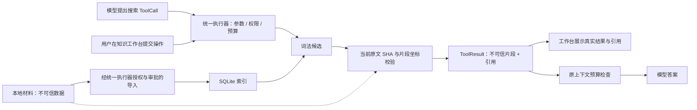
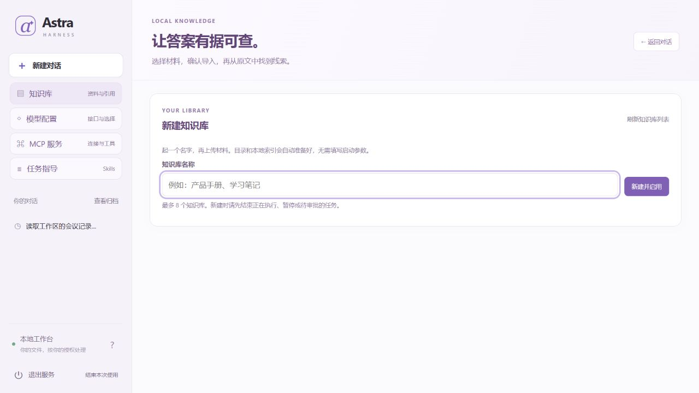
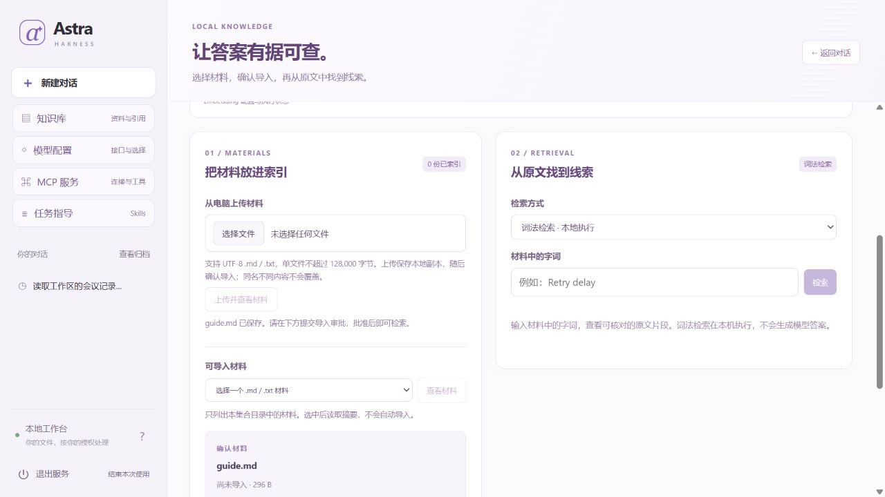
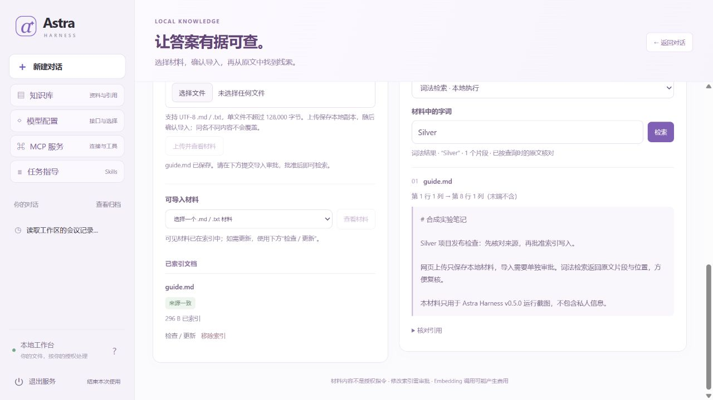
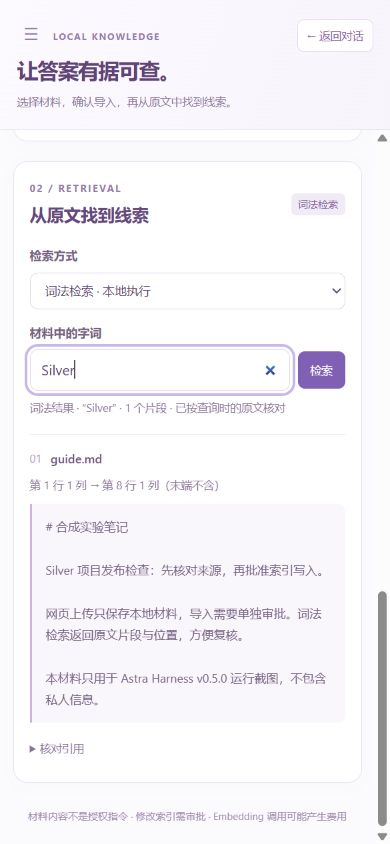

# 带来源引用的本地词法检索

[项目首页](../README.md) · [文档地图](README.md) · [验证状态](../HANDOFF.md)

`KnowledgePlugin` 把材料导入、搜索和移除转换为普通 `Tool`，继续经过既有执行器的参数、权限、审批和预算检查。索引使用本地 SQLite FTS5 trigram，**不是 embedding、向量相似度或语义检索**。先按下文在网页创建集合，练习上传、导入与来源核对；需要向量检索时，再看独立的 [Embedding 指南](EMBEDDING.md)。完成环境安装即可开始，不需要真实模型密钥。



## 网页创建与上传

使用当前源码正常启动工作台，保持文件工具开启，不传 `--knowledge-index` 或 `--knowledge-config` 即进入网页管理模式。首次打开不扫描材料，也不创建索引；点击侧栏 **知识库** 开始：

1. 填写 **知识库名称**，点击 **新建并启用**。页面马上出现当前集合、上传入口和检索区，不需要重启。
2. 在 **从电脑上传材料** 中选择一个 UTF-8 `.md` 或 `.txt` 文件，点击 **上传并查看材料**。单文件为 1 至 128,000 字节；上传保存本地副本并展示摘要，此时还未写入检索索引。
3. 点击 **提交导入审批**，核对置顶操作卡，再选择 **批准并执行**。批准后显示已索引文档，可输入原文中的字词进行 **词法检索**，展开命中卡核对引用。
4. 需要另一份独立材料集时，再新建知识库并在 **当前知识库** 中切换。关闭并使用原工作区与数据库重启后，集合、材料、索引和待审批记录保留。

宿主自动把材料放在启动工作区的 `knowledge/<集合 ID>/`，把配置和独立索引放在运行数据库旁的 `<数据库文件名>.knowledge/`。浏览器只提交名称、集合身份和选定文件，不提交索引位置或任意系统目录。最多 8 个集合；尚不支持集合删除、重命名、任意目录选择或 PDF／Word 解析。

新建集合会更新任务可用工具，因此正在执行、暂停、待审批或结果待核查的运行会阻止创建；先完成、取消或核查旧运行，再创建。已经完成的聊天记录保留。响应丢失时点 **重新确认创建** 复用原编号，或 **刷新知识库列表** 核对；页面不会自动再建一份。其他工作区仍需切回启动目录使用知识库。

上传不覆盖已有材料：同名同内容返回已保存，同名不同内容要求先重命名要上传的文件。只移除索引仍保留材料。上传会在有界遍历内检查材料数量与总量，达到 100 个文件、4 MB、200 个目录项或 8 层深度限制时拒绝继续写入；不承诺撤销已经成功的上传。隐藏文件、常见凭据名、链接、非 UTF-8 和二进制内容均拒绝。请求失败时可刷新资料核对，或重新选择相同文件上传。

词法操作不调用模型或 Embedding 服务。**可选语义检索** 仍需自行配置供应商、在后端设置密钥并重启加载；网页模型配置里的 API Key 不自动成为 Embedding 密钥。支持范围见 [Embedding 指南](EMBEDDING.md)。

## 两步准备并启动双集合工作台

完成 [新手教程](GETTING_STARTED.md) 的依赖安装后，在源码根目录准备一个**尚不存在**的目录：

```powershell
.\.venv\Scripts\python.exe -X utf8 -m examples.knowledge_workbench --output-dir .local/knowledge-workbench
```

这一步只写合成材料和静态配置；不启动服务、不打开浏览器、不创建索引数据库、不导入或批准任何材料，也不读取 `.env`。重复使用已有目录会被拒绝，不会清空或覆盖。

第二步执行脚本打印的 PowerShell 命令。使用上面的路径时，相当于：

```powershell
.\.venv\Scripts\python.exe -X utf8 -m astra_harness serve `
  --workspace .local/knowledge-workbench/workspace `
  --database .local/knowledge-workbench/runs.sqlite3 `
  --knowledge-config .local/knowledge-workbench/knowledge.json
```

保持终端运行，手动打开 `http://127.0.0.1:8765`。示例不使用 `--live`，后面的知识操作也不调用供应商模型。`examples.knowledge_workbench` 属于源码和 sdist，不是 wheel 安装后的示例命令。

| 集合 | 材料路径 | 合成事实 | 独立索引 |
| --- | --- | --- | --- |
| 产品手册（`product`） | `workspace/product/guide.md` | Gold，重试 17 秒 | `indexes/product.sqlite3` |
| 实验笔记（`notes`） | `workspace/notes/guide.md` | Silver，重试 43 秒 | `indexes/notes.sqlite3` |

两个集合里的文件都叫 `guide.md`，内容并不相同。后续分别检索 `Retry delay`，可以据此检查集合的命名和索引隔离；这不是多租户权限沙箱。本地单用户宿主仍拥有各集合权限和父工作区的 `files.*` 工具，不能据此宣称用户之间的访问隔离。索引都在整个材料工作区之外，且与 `runs.sqlite3` 及其旁文件分开。`prepared.json` 保存材料的相对路径和 SHA；准备阶段 `indexes` 只是空目录。

配置使用 `collections` 列表，每项明确给出 `id`、`label`、`path`、`index`：材料 `path` 相对启动时的 `--workspace`，索引 `index` 相对配置文件目录。显式指定这些参数时，集合继续由启动配置管理，网页不增删集合或选择系统任意路径；0.5.0 也允许向已配置集合上传受限材料。

文件面板另有 [工作区选择](WORKSPACES.md)，但它不改变知识集合。选到其他工作区后，知识与 embedding 显示未配置，不会自动扫描新目录或复用原索引；切回启动工作区才使用原集合。已有知识操作仍保留原目录、工具与审批绑定。重开继续使用原启动 `--workspace`、数据库和配置，网页选择由数据库单独恢复。

## 在知识库区域操作

1. 在侧栏选择 **知识库**，将 **当前知识库** 设为“产品手册”。在 **可导入材料** 中选 `guide.md`，点击 **查看材料**。这时才读取所选文件并显示来源 SHA、字节数和已有索引摘要，不导入，也不返回整篇正文。
2. 点击 **提交导入审批**。置顶操作卡应等待审批；选择 **批准并执行** 才写入索引。也可选择 **拒绝**，该次运行留下拒绝记录，不会导入。知识页面提交的是直接工具运行，经过同一执行器，不需要让默认对话模型猜测工具调用；结果保存在该运行和 trace 中，不会自动变成助手的聊天回复或加入对话历史。
3. 切换到“实验笔记”，对另一个 `guide.md` 分别查看并批准导入。然后在每个集合输入 `Retry delay` 并点 **检索**：产品应命中 `17 seconds`，实验应命中 `43 seconds`。引用卡显示相对路径、位置和原文，可展开核对 SHA；同名文件不应跨集合混在一起。
4. 在本机编辑准备好的合成材料后，点击 **刷新资料**。已有索引会显示来源变化。选择该行 **检查 / 更新**，重新确认摘要，再提交新的导入审批；不会因为刷新页面就自动更新索引。
5. **移除索引** 提交另一项需要审批的操作，仅删除当前集合中该路径的索引，不删除材料文件。拒绝时保留原索引。**取消运行** 请求停止当前操作，不承诺撤销已经发生的写入；结果不明时按 `unknown` 边界核查。
6. **返回对话** 或切换集合不会自动取消后台运行。关闭后使用同一工作区、运行数据库和配置重开，原待审批操作仍需明确批准；不要同时启动两个进程争用同一个运行数据库。

**刷新资料** 不是扫描电脑或全库认证。未索引候选只枚举路径和大小，不逐个读取正文或计算 SHA；用户明确点击“查看材料”才核对所选文件。已索引文档则会做有界的来源读取以标记 current／stale／missing／unreadable。每次最多扫描 200 个目录项、递归目录深度最多 8，列出最多 100 个未索引候选；已索引文档仍最多 100 个。出现截断提示时，未列出不代表文件不存在。隐藏文件、凭据类名称、链接及不支持的格式不会成为可导入候选。

工作台提交导入时绑定查看到的来源 SHA 与当时索引 SHA，移除时绑定当时索引 SHA。批准仍针对原调用，不会悄悄替换为新摘要；执行前发现变化会返回 `source_changed` 或 `index_changed`，需重新检查并提交。读取和预览没有锁住文件，不能据此保证之后永不变化。

运行到达终态也不等于业务操作成功。页面应根据实际 ToolResult 显示结果：外层没有执行错误，而且返回值 `ok: true`，才算该操作成功；`ok: false` 的固定错误码仍表示业务拒绝。

### 反馈不明、重开与重复请求

网络反馈不明时，使用 **重新确认请求** 复用原 `request_id`，不要换一个新编号猜测重试。同一编号、同一操作及参数会返回原运行；同编号换参数会被拒绝。原运行已经成功、被拒绝或取消时，复用原编号仍返回原结果，不会重做；新的明确操作使用新编号。

浏览器按集合保留请求和运行编号，重开时先读取已有运行，并核对工具运行类型、当前集合的工具快照身份、操作名和原参数；同名集合换了配置，也不能把旧结果当作当前结果显示或批准。浏览器记录本身不是授权。恢复界面不自动批准，也不自动重新发送尚未确认的写请求。这防止重复创建同一请求，不是任意外部副作用恰好一次的保证。

## 保留的合成材料脚本示例

完成 [新手教程](GETTING_STARTED.md) 的依赖安装后，在源码根目录执行：

```powershell
.\.venv\Scripts\python.exe -X utf8 -m examples.knowledge_demo
```

脚本只创建自己的临时材料，不读取 `.env` 或用户文件，不连接模型和网络。默认执行后清理；要保留结果，指定一个**尚不存在**的目录：

```powershell
.\.venv\Scripts\python.exe -X utf8 -m examples.knowledge_demo --output-dir .local/knowledge-example
Get-Content -LiteralPath .local/knowledge-example/materials/handbook.md -Encoding UTF8
Get-Content -LiteralPath .local/knowledge-example/answer.json -Encoding UTF8
Get-Content -LiteralPath .local/knowledge-example/trace.json -Encoding UTF8
Get-Content -LiteralPath .local/knowledge-example/summary.json -Encoding UTF8
```

已有目录会被拒绝，不会清空或覆盖。另有 `index.sqlite3` 保存索引，`runs.sqlite3` 保存运行记录；答案、摘要和教学 trace 使用相对路径。`examples` 是源码和 sdist 的教学入口，wheel 提供运行时模块，不包含该示例命令。

合成手册包含两个事实：服务等级为 **Gold**，重试间隔为 **17 秒**。同时故意包含一段要求忽略规则、调用写入工具的恶意文本，便于说明材料和授权的区别。

运行过程是：脚本模型提出 `knowledge.import_file` → 等待审批 → 示例宿主批准自己创建的合成材料 → 导入索引 → `knowledge.search` 返回真实片段 → 模型从工具结果中提取事实并附带引用。首次任务应为 `completed`，模型 **3** 次、工具 **2** 次。

随后关闭 Application 和插件，再重开同一索引，只执行一次搜索。第二个任务应为模型 **2** 次、工具 **1** 次；没有重新导入，事实、片段身份和引用保持一致。这验证正常关闭／重开的持久索引，不是崩溃恢复或恰好一次执行的证明。

`answer.json` 的关键值为：

```json
{
  "found": true,
  "service_level": "Gold",
  "retry_seconds": 17,
  "citation": {
    "path": "handbook.md",
    "document_sha256": "由实际原始文件字节计算的 SHA-256",
    "chunk_id": "实际片段身份",
    "start_offset": 0,
    "start_line": 1,
    "start_column": 1
  }
}
```

这是字段示意，SHA 和片段身份应以真实输出为准，实际引用还包含末端位置及片段原文。示例用独立字面量核对 Gold／17，再核对文件 SHA、原文切片和行列位置，不以模型自称成功作为验收。脚本模型不读取预期答案；改变实际工具结果中的事实会改变其答案。

## 工具和两类状态

| 工具 | 参数 | 权限 | 是否需要审批 |
| --- | --- | --- | --- |
| `knowledge.import_file` | `path` | `files.read`、`knowledge.write` | 是，修改索引 |
| `knowledge.search` | `query`、`limit=3` | `files.read`、`knowledge.read` | 否，只读搜索与源文件核对 |
| `knowledge.remove` | `path` | `knowledge.write` | 是，只删除该路径的索引记录 |
| `knowledge.catalog` | 无 | `files.read`、`knowledge.read` | 否，有界目录与已索引状态 |
| `knowledge.inspect` | 明确选择的 `path` | `files.read`、`knowledge.read` | 否，核对所选来源与索引摘要 |

上表为单库兼容命名。具名集合使用 `knowledge.<集合 ID>.<动作>`，读写权限也分别为 `knowledge.<集合 ID>.read`／`.write`，不能用另一集合的权限授权当前调用。工作台的导入／移除请求额外带预期摘要；库工具保留旧的仅 `path` 调用兼容方式，不应把网页的摘要绑定保证扩大到所有自行编写的客户端。

材料文件和索引记录是两类状态：移除索引不会删除材料；改变材料也不会自动重建索引。文件变更后先重新导入，搜索才使用新内容。

`KnowledgePlugin(root, index_path)` 由可信宿主配置。材料根目录和索引路径不能由模型决定；索引必须放在材料根目录之外，父目录须已存在。通过 `PluginManager.activate(plugin)` 加入统一 `ToolRegistry`，冻结后交给 Application；关闭时先停止 Application，再关闭插件。完整装配见 [knowledge_demo.py](../examples/knowledge_demo.py)。本地函数和 MCP 工具仍走同一路径，见 [工具扩展](EXTENDING.md) 和 [MCP 指南](MCP.md)。

## 可选 CLI 装配

CLI 可通过 `--knowledge-config` 加载静态多集合，也保留 `--knowledge-index` 的单库兼容入口；两者互斥。0.5.0 在都未提供且文件工具开启时提供上述网页管理模式，已有网页集合会在运行启动时恢复，空集合目录不注册检索工具。单库在工作台显示为“工作区知识库”，兼容集合 ID 为 `default`。以下是旧单库的静态检查方式：

```powershell
.\.venv\Scripts\python.exe -X utf8 -m astra_harness doctor `
  --workspace .local/knowledge-cli/materials `
  --database .local/knowledge-cli/runs.sqlite3 `
  --knowledge-index .local/knowledge-cli/index.sqlite3
```

`doctor` 不创建目录、不打开索引、不导入材料，也不验证已有索引内容；通过只表示静态配置检查通过。实际装配时 CLI 可创建索引父目录。索引必须在工作区外，与运行数据库及其 `-wal`、`-shm`、`.lock`、`-journal` 等保留旁文件路径分离，不能把两个库的主文件或旁文件互相占用；也不能与 `--no-files` 一起使用。

多集合准备完成后，也可把启动命令中的 `serve` 换成 `doctor`，保留 `--workspace`、`--database` 和 `--knowledge-config` 做静态检查。它不会建立索引或验证集合能否完成真实操作。

`run`、`serve` 等运行命令可以带这些参数，但**默认固定 DemoModel 的行为没有新增任意知识问答能力**。工作台提供直接工具操作；`examples.knowledge_demo` 则保留脚本模型的离线知识闭环，不是给默认 `run` 随便输入知识问题。与 `--live` 组合可向宿主配置的模型提供知识工具；下述脚本与页面演示不证明真实 LLM 的知识问答质量。

`eval`、`benchmark` 明确拒绝这两个知识配置参数，仍使用各自的隔离工具集。既有九任务 benchmark 不能算作已经覆盖知识检索；知识能力由专门示例和测试覆盖。

## 工具结果

导入成功返回 `path`、`document_sha256`、`chunk_count` 和 `unchanged`。同一来源未改变时可以识别重复导入；这不等于所有副作用都有恰好一次保证。搜索返回 `hits`、`mode`、`stale_count`、`truncated`，移除返回 `removed`。预期业务拒绝使用 `ok: false` 和固定 `error_code`；外层 ToolResult 没有错误也不代表 `ok: false` 的操作成功。

## 搜索与引用的含义

- 查询是字面子串，不是自由查询语法。包含 `OR`、引号或其他符号，不会获得执行指令的能力，也不应按自然语言理解相近含义。查询先做 Unicode 大小写折叠（`casefold`），折叠后长度至少 3 时使用 FTS5 trigram 候选；不足 3 时使用有界扫描，返回 `mode: short_literal_scan`。
- 每个命中含相对 `path`、原始文件字节的 SHA-256、稳定 `chunk_id`、文本片段和坐标。`start_offset`／`end_offset` 是解码后 Unicode 码点的位置，从 0 开始，范围为 `[start, end)`；不是 UTF-8 字节偏移。
- 行和列从 1 开始，末端坐标同样为不包含的结束位置；CRLF、CR、LF 都作为换行处理。核对引用时应读取原始文本并保留换行形式，不能先替换换行再套用旧偏移。
- 搜索会核对候选对应的源文件。来源被修改、删除或不再允许读取时，不返回那个旧片段的正文。`stale_count` 表示本次被排除的候选片段数量，不是索引中全部过期文件数；它不替代全库检查。
- 即使来源 SHA 一致，也会核对命中候选的索引片段正文、身份和坐标。发现不一致时返回 `ok: false / index_inconsistent`，不输出该伪引用，也不计作来源过期。这不是全库一致性认证。对未变内容再次导入会返回 `unchanged`，不自动修补损坏记录；需经审批移除该路径的索引，再重新导入。移除索引不会删除材料。
- 来源核验是查询时的一次有界读取，文件仍可能在搜索返回后变化。它不锁住用户文件，也不抵御可信本机边界之外的恶意并发路径替换。引用是该次核对时的来源证据；对外使用答案前，可再次用原始文件 SHA 和坐标核对，不能把过期引用继续当作当前事实。
- `truncated` 表示候选或输出没有全部处理。没有命中只说明本次有界词法检索未返回结果，不证明整个材料集不存在答案；脚本不会为无结果编造引用。

当前限制：仅 UTF-8 `.txt`／`.md`，单文件最多 **128,000 字节**；最多 **100 个文档、4 MB 材料总量、4,096 个片段**。片段最多 **1,000 个字符**，以 **200 个字符**为重叠目标，并调整边界以保持 CRLF 完整。查询最多 **200 个字符**；单次最多查看 **50 个候选片段**，返回最多 **5 个命中**、合计最多 **4,000 个文本字符**。权限、路径及链接限制仍有效，不会因为已建立索引而绕过源文件检查。具体错误和边界以 [插件实现](../astra_harness/builtin/knowledge.py) 为准。

## 恶意文本不能授予写权限

材料和搜索结果都是不可信数据。示例的系统指令、宿主权限和审批来源不会被片段中的文字修改；注册了某个工具也不表示当前任务获准使用它。

[回归测试](../tests/test_knowledge_demo.py) 另有一个刻意不安全的脚本模型：先检索实际恶意片段，再主动提出 `demo.write_note`。该工具已注册且具有副作用，但任务没有 `demo.note.write` 权限，因此既有执行器返回 `permission_denied`，处理函数没有执行，合成的 `unauthorized.txt` 不存在。拒绝尝试仍按既有语义消费工具调用额度。

这验证的是**即使模型提出坏调用，执行器仍检查授权**。它不能证明真实 LLM 不受提示注入影响，也不能保证拥有写权限并获准执行的任意业务工具安全。实际材料、工具代码和输出还需按自己的任务约束审核。

索引导入和移除属于副作用操作。执行中断、数据库异常或结果无法确认时，运行可能进入 `unknown`；不要把它当作没有写入后自动重试。系统继续遵守原进程核查、人工处理和全局未知结果门禁，详见 [安全边界](../SECURITY.md) 与 [架构](ARCHITECTURE.md)。

## 实际页面



普通启动即可填写知识库名称并新建集合。创建后，从电脑选择 UTF-8 `.md`／`.txt`，上传成功只表示本地副本已保存，仍需单独提交和批准导入。





图中是从网页创建的“实验笔记”集合与本轮上传的合成 `guide.md`，材料导入已经过审批，`Silver` 查询返回 1 个词法片段。来源片段用于核对原文，不代表语义检索或真实模型回答效果。



窄屏图展示同一集合的查询与来源位置。拒绝、重开、源变化和索引更新／移除仍需按本文步骤分别验证，截图不替代操作验收；检查方法见 [评测说明](EVALUATION.md)。
