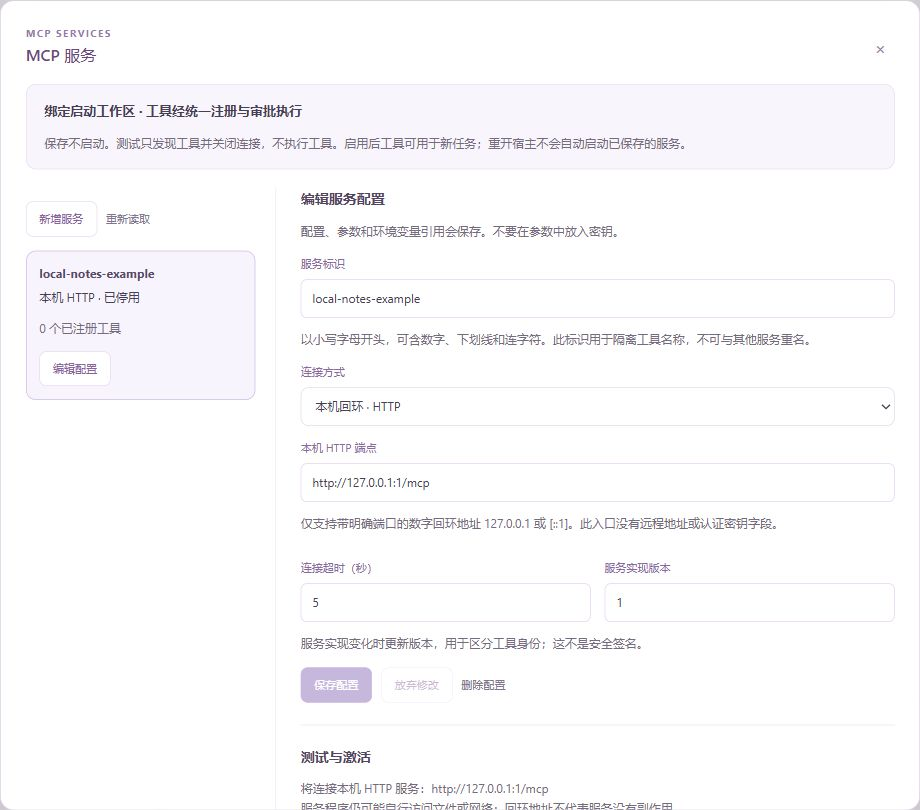
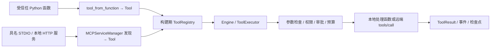

# 把多个本地 MCP 服务接入同一执行器

[项目首页](../README.md) · [文档地图](README.md) · [当前交接](../HANDOFF.md)

本文面向需要通过启动配置接入工具的开发者，介绍具名 **STDIO 子进程服务** 和本机 HTTP 服务。协议范围为 **`2025-06-18`** 的初始化、工具发现和工具调用子集，不表示支持最新完整协议或替代完整 MCP SDK。已有普通 Python 函数时，可先用 [工具扩展入口](EXTENDING.md)，无需把所有函数包装成 MCP 服务。

以下示例采用 `--mcp-config` 静态入口：启动宿主时装配服务。希望在页面保存、发现、明确启用并管理服务时，请改读 [MCP 档案指南](MCP_PROFILES.md)；两种入口共用执行器，配置格式与连接生命周期分别说明。

HTTP 与 STDIO 各有独立的本地示例；请按实际选用的传输核对连接、工具结果和清理行为。示例范围与结果解释见 [评测说明](EVALUATION.md)。



图中 `local-notes-example` 已停用，显示 `0` 个工具，展示的是 MCP 配置管理入口，不能据此认定服务已连接或工具已发现。桌面与 [390 像素窄屏截图](images/mcp-services-mobile-current.jpg) 展示同一停用配置；下文的 STDIO 与 HTTP 示例需要单独运行，图中没有展示它们的执行结果。

## 先运行已有的 STDIO 离线示例

按 [新手教程](GETTING_STARTED.md) 安装项目依赖，在源码根目录执行：

```powershell
.\.venv\Scripts\python.exe -X utf8 -m examples.mcp_services_demo
```

示例启动自写的本地 Python STDIO 子进程，不下载服务程序、不读取 `.env`、不调用模型或网络，也不需要额外 MCP SDK。默认使用临时目录，结束后清理。要保留合成产物，指定一个**尚不存在**的目录：

```powershell
.\.venv\Scripts\python.exe -X utf8 -m examples.mcp_services_demo --output-dir .local/mcp-example
Get-Content -LiteralPath .local/mcp-example/summary.json -Encoding UTF8
Get-Content -LiteralPath .local/mcp-example/children/alpha.jsonl -Encoding UTF8
Get-Content -LiteralPath .local/mcp-example/children/beta.jsonl -Encoding UTF8
Get-Content -LiteralPath .local/mcp-example/trace.json -Encoding UTF8
```

已有目录会被拒绝，不会清空或覆盖。输出目录还包含 `mcp.json` 和 `runs.sqlite3`；前者是本机实际启动配置，含解释器和脚本路径，不要当作可移植公开报告。`summary.json` 使用相对路径与脱敏服务状态。`examples` 属于源码和 sdist，wheel 提供运行时模块，不包含这个教学命令。

三个服务的结果可独立核对：

| 服务 | 远端工具名 | 本地注册名 | 示例行为 |
| --- | --- | --- | --- |
| `alpha` | `record` | `mcp.alpha.record` | 批准后记录合成数量 `7` |
| `beta` | `record` | `mcp.beta.record` | 独立批准后记录合成数量 `11` |
| `broken` | 不注册 | 不注册 | 初始化版本不匹配，状态为 `failed` |

固定脚本模型先提出 alpha 调用。宿主确认没有执行后显式批准，alpha 子进程将真实收据写入自己的 JSONL，再返回工具结果。模型接着提出 beta 调用，运行再次进入 `waiting_approval`。

此时示例关闭 Application，再关闭插件及其子进程；使用同一配置重开后，beta 仍等待原审批，已用预算仍为模型 **2** 次、工具 **1** 次。独立收据确认 alpha 没有重放。宿主批准 beta 后，模型把两个实际工具结果交给本地 `local.total`，最后读取真实合计结果。

成功输出应为：

```json
{
  "status": "completed",
  "output": "Verified tool total: 18",
  "model_calls": 4,
  "tool_calls": 3,
  "recorded_values": {"alpha": [7], "beta": [11], "broken": []},
  "child_instances": {"alpha": 2, "beta": 2, "broken": 2},
  "first_call_replayed": false,
  "second_approval_preserved": true
}
```

这是输出的关键字段摘录。每个服务有两次实际启动，`recorded` 收据则分别只有一条、一条、零条。断言使用字面量预期 `7、11、18`，不把模型声称成功当作验收。脚本代表宿主批准自己的合成任务；实际应用应把决定交给用户或可信策略。

拒绝第二次审批也可以独立演示：

```powershell
.\.venv\Scripts\python.exe -X utf8 -m examples.mcp_services_demo --deny
```

此时 `passed: true` 表示拒绝场景符合预期；任务本身为 `failed / approval_denied`，模型 **2** 次、工具 **1** 次，alpha 保留 `[7]`，beta 没有收据。本例是宿主的正常关闭／重开和真实子进程重启，不是宿主进程崩溃注入，也不保证任意外部副作用恰好执行一次。

## 回环 HTTP 接入

HTTP 服务由可信宿主提前启动，Astra 连接它的固定 endpoint；管理器不会按 URL 启动服务程序。具名配置示意如下：

```json
{
  "servers": [
    {
      "name": "local_http",
      "transport": "http",
      "endpoint": "http://127.0.0.1:8766/mcp",
      "timeout": 10,
      "revision": "1"
    }
  ]
}
```

只接受数值回环地址 `127.0.0.1` 或 `[::1]` 的 `http` URL，且必须显式给出端口和路径，例如 `http://[::1]:8766/mcp`。不接受 `localhost` 等主机名、其他本机／局域网／公网地址、HTTPS、URL 凭据、查询参数或片段。HTTP 条目不能同时提供 `command`；没有认证、Bearer token、自定义请求头、Cookie 或 OAuth 配置入口。

从源码根目录运行 HTTP 示例：

```powershell
.\.venv\Scripts\python.exe -X utf8 -m examples.mcp_http_demo
```

示例实际连接自己启动的回环 HTTP 服务，使用合成数据，通过 `Application.submit_tool` 运行已注册工具；没有模型步骤，也不连接第三方服务。宿主仅批准本例自己创建的合成任务。默认临时目录在结束后清理；保留结果时指定新目录：

```powershell
.\.venv\Scripts\python.exe -X utf8 -m examples.mcp_http_demo --output-dir .local/mcp-http-example
Get-Content -LiteralPath .local/mcp-http-example/summary.json -Encoding UTF8
Get-Content -LiteralPath .local/mcp-http-example/json/receipts.json -Encoding UTF8
Get-Content -LiteralPath .local/mcp-http-example/uncertain/receipts.json -Encoding UTF8
Get-Content -LiteralPath .local/mcp-http-example/uncertain/trace.json -Encoding UTF8
```

已有目录会被拒绝，不会覆盖。四个场景的预期分别为：

| 场景 | 协议行为 | 运行状态 | 独立服务收据 | 模型／工具计数 |
| --- | --- | --- | --- | --- |
| `json` | 返回 JSON 工具结果 | `completed` | `27` 一次 | `0 / 1` |
| `sse` | POST 返回 SSE 工具结果 | `completed` | `31` 一次 | `0 / 1` |
| `denied` | 宿主拒绝审批 | `failed / approval_denied` | 无 | `0 / 0` |
| `uncertain` | 服务记录 `43` 后断开，结果未确认 | `unknown` | `43` 一次 | `0 / 1` |

`passed: true` 表示这些预期均成立，不能把它解释为四项任务全部完成。最后一项保留未知状态并检查新执行被门禁阻止，不自动重放；收据证明该次合成效果确实发生。每个场景目录有运行数据库、收据和教学 trace。可从 [示例源码](../examples/mcp_http_demo.py) 查看实际判断；它不证明第三方服务互通、认证、真实 LLM 能力或任意副作用恰好一次。

### 支持的 HTTP 交互

实现依据 [Streamable HTTP 传输](https://modelcontextprotocol.io/specification/2025-06-18/basic/transports) 与 [初始化生命周期](https://modelcontextprotocol.io/specification/2025-06-18/basic/lifecycle)，仅覆盖以下工具交互：

- 向同一个 endpoint POST 单个 JSON-RPC 消息；初始化后发送 `notifications/initialized`，再执行工具发现和调用。请求声明接受 `application/json` 与 `text/event-stream`，支持 POST 返回 JSON 或 SSE。
- 初始化返回合法 `Mcp-Session-Id` 时，后续请求使用该会话标识，同时携带 `MCP-Protocol-Version: 2025-06-18`。会话标识只允许 1–256 个可见 ASCII 字符，是连接状态，不是用户身份或授权。
- 每个请求的 `timeout` 包含锁等待、发送和接收完整匹配结果的时间，持续分块或进度信息不会重置总期限。宿主默认限制为每次请求／响应最多 1,000,000 个原始字节；SSE 最多处理 64 个带 data 的消息，注释同样受总字节和期限限制。响应头检查上限为 16 KiB，不接受压缩响应。
- 本地取消后，最多用 0.2 秒尝试发送 `notifications/cancelled`。关闭有会话标识的连接时，最多用 0.25 秒尝试一次 DELETE，只检查状态、不读取其正文，再最多用 0.5 秒关闭本地 HTTP 客户端。DELETE 的 404 表示会话已过期，405 表示服务不允许该结束方式；这些状态都不证明远端业务效果已撤销，也不终止服务进程。

这是明确收缩的客户端子集：不建立 GET 通知订阅，不实现旧 HTTP+SSE 兼容回退、断线游标续传或完整通知语义。POST 的 SSE 内收到服务端 `ping` 时回复空结果，其他服务端请求回复不支持方法；它们不能调用本地业务工具。通知不会改变注册表或授权。会话失效不会自动创建新会话或重放原工具。即使其他客户端支持这些行为，也不能据此推定当前实现支持。

HTTPX 使用显式配置，关闭环境代理和重定向，不复用 Cookie，不自动重试。服务请求已经发出后，断流、超时或本地取消都不能证明服务端未执行；结果无法确认时仍保留 `unknown`。停止读取或发送 DELETE 不是远端业务取消的完成证明。

### 静态检查与恢复身份

HTTP 同样通过 `--mcp-config` 装配。`doctor --mcp-config mcp.json` 只校验结构和 endpoint，不创建 HTTP 客户端、不连接服务、不发 DELETE，也不能证明 endpoint 可用。

HTTP 的恢复身份绑定服务名、命名空间、传输、规范化 endpoint、协议、超时、固定限制、revision 和授权策略，不绑定启动目录。更换 endpoint 不能沿用原运行或旧审批；同一 endpoint 后面的程序内容变化仍应由宿主更新 revision，配置身份不是服务器二进制的证明。STDIO 的工作目录身份与旧兼容方式保持原规则。

## 本地函数与 MCP 使用相同的调用路径



`PluginManager` 在注册表之外管理服务的启动与清理。示例先注册 `tool_from_function` 生成的本地工具，再通过 `plugins.activate(manager)` 注册远端工具，冻结注册表后交给 Application。调用都经过既有执行器；服务管理器没有另一套 Agent 循环。关闭时先停止 Application 的工作线程，再清理插件。完整装配见 [mcp_services_demo.py](../examples/mcp_services_demo.py)。

## 配置与明确授权

具名配置使用以下结构；命令数组由可信宿主提供，不经过 shell，不接受模型生成的命令：

```json
{
  "servers": [
    {
      "name": "alpha",
      "command": ["python", "trusted_server.py"],
      "timeout": 10,
      "revision": "1"
    }
  ]
}
```

这只是配置格式示意，`trusted_server.py` 必须由你提供和审核。可先做静态检查：

```powershell
.\.venv\Scripts\python.exe -X utf8 -m astra_harness doctor --mcp-config mcp.json
```

`doctor` 只检查配置结构和限制，不启动子进程、不连接 HTTP、不发现工具、不证明服务可用。CLI 的 `--mcp-config` 是宿主授权装配入口：它加载服务并为 Application 配置相应调用权限；每次远端调用仍须审批。库集成则由宿主在 `Application(..., permissions=...)` 中明确给权，不能从模型文本取得授权。

- 服务名使用小写字母开头的字母、数字、`_` 或 `-`，最多 32 字符，名称不能重复。配置最多 8 个服务、65,536 字节；发现的工具总数最多 200。
- `alpha` 工具名是 `mcp.alpha.<远端名>`，权限是 `mcp.alpha.call`；`mcp.beta.call` 不能授权 alpha。所有远端工具保守标记为 `side_effect=True`、`requires_approval=True`，不信任远端自报的只读属性来放宽审批。
- `timeout` 默认 10 秒，可配置为大于 0、最多 300 秒；单条协议消息有 1,000,000 字节上限。工具 Schema 仍受项目已实现子集限制，不会跳过未知约束。
- `revision` 默认 `1`。STDIO 的命令、配置加载时的工作目录、超时、协议、策略和 revision 等宿主配置生成恢复身份 SHA，工具 Schema 另由运行快照核对。相对命令路径以该工作目录为基准，换启动目录会使原运行的配置身份不匹配。它绑定配置，**不证明可执行文件、脚本或外部依赖内容未变**；改变服务实现时应显式更新 revision。
- 参数、权限或配置改变不能沿用旧审批或旧运行快照。对于命令路径未变、脚本内容已变但 revision 未更新的情况，不能声称系统会自动发现。

旧配置 `{"command": ["python", "trusted_server.py"]}` 仍只支持 STDIO，保留单服务的 `mcp.<远端名>`、`mcp.call` 命名，以及原有恢复快照兼容方式；启动失败仍整体报错，不获得具名服务的新配置身份保证。新旧配置格式不能混合。具名 STDIO 条目可省略 `transport`，或显式使用 `"transport": "stdio"`。

## 故障与生命周期边界

具名服务在初始化或发现阶段失败时只记录固定错误码，不注册该服务的工具；健康服务仍可用。`manager.status()` 和应用信息只公开服务名称、状态、固定错误码、传输类型和工具名，不公开 argv、环境变量或 PID。配置中的程序本身仍是可信本地代码，进程隔离不等于操作系统权限沙箱。

本节静态工具目录在构建后冻结；动态档案只可在宿主明确保留的空闲边界发布新工具集合，不能改写旧运行快照。运行期间断连不会自动替换工具、重连或重放；再次调用不可用服务会在发送前拒绝。调用已经发出但结果无法确认时可能进入 `unknown`，不能当作未执行后重试。**连接故障的隔离不取消 Application 的全局 unknown 门禁**：存在未核清的副作用时，其他任务也可能被阻止，必须按 [安全边界](../SECURITY.md) 核查原进程和实际效果。

STDIO 与本地 HTTP 都只提供工具子集；不包含授权服务、资源／提示模板、采样或完整通知语义。STDIO 关闭仅管理自己启动的子进程及可确认的进程树，不宣称能约束主动脱离进程树的恶意程序；HTTP 关闭不负责终止服务进程。清理不完整会保留固定错误码，并在尝试清理其他服务后报错；不能只看到 `closed` 状态就断言远端资源全部回收。

STDIO 示例与回归见 [子进程实现](../examples/mcp_demo_server.py)、[STDIO 测试](../tests/test_mcp_demo.py)；HTTP 示例另有 [回环服务](../examples/mcp_http_server.py) 和 [四场景测试](../tests/test_mcp_http_demo.py)。本地函数接入见 [工具扩展指南](EXTENDING.md)，运行与恢复规则见 [架构](ARCHITECTURE.md)。
