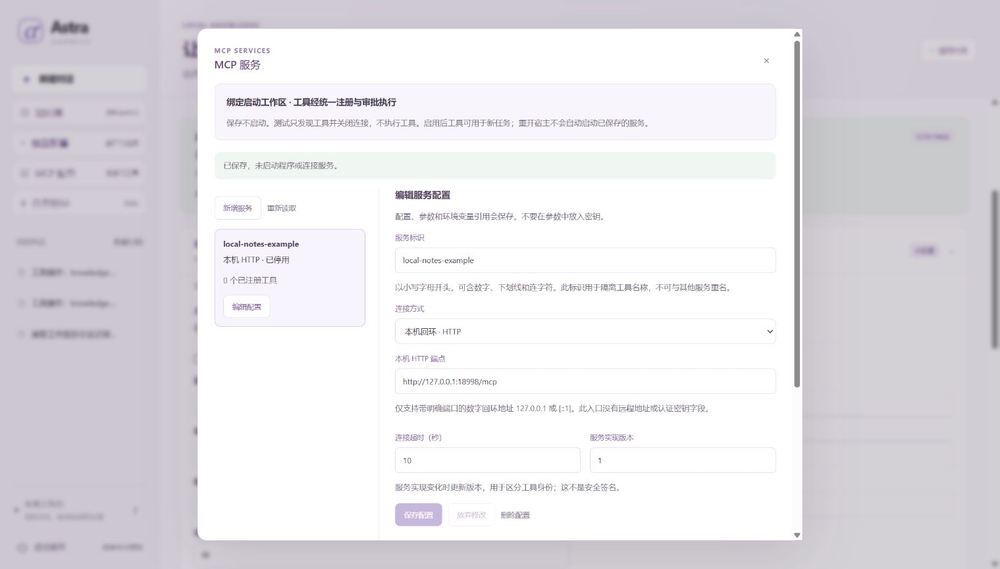

# 在页面管理 MCP 服务

[项目首页](../README.md) · [文档地图](README.md) · [验证状态](../HANDOFF.md)

本页面向希望添加本地 MCP 服务、无需编写 Python 注册代码的使用者。先完成 [新手入门](GETTING_STARTED.md)；若要把服务写入启动配置，使用 [MCP 指南](MCP.md) 的 `--mcp-config` 入口。

MCP 档案保存你选择的本地程序或本机 HTTP 端点，再把发现的工具接入统一执行器。**保存、测试、启用和调用是四个不同动作**：保存不启动服务，测试只发现工具，启用才注册工具，每次实际调用仍需审批。启用 MCP 不会自动配置任务模型或加载 Skill。

**阅读路线：** [合成示例](#先用合成服务理解流程) → [保存与启用](#从保存到启用) → [连接字段](#两种连接的字段) → [停用与重开](#停用编辑删除和重开)。遇到操作被阻止时查看 [运行边界](#为什么有时不能测试或启用)。



图中 `local-notes-example` 已停用，显示 `0` 个工具；它展示保存后的停用配置，不表示服务已连接或工具已发现。连接、工具发现与调用应按下文的显式操作分别核对。

## 先用合成服务理解流程

在已安装锁定依赖的源码根目录运行：

```powershell
.\.venv\Scripts\python.exe -X utf8 -m examples.mcp_profiles_demo
```

示例使用自编本地服务和合成数据，直接工具运行不请求任务模型。默认在临时目录执行后清理；需要保留配置、运行和合成收据时传 `--output-dir` 指定一个尚不存在的目录，已有目录拒绝覆盖。它用于核对配置生命周期与工具执行路径，不代表第三方服务可靠性、真实模型能力或操作系统隔离。如何区分这些验证范围，见 [评测说明](EVALUATION.md)。

预期输出 `passed: true`、`run_count: 5`、`tool_calls: 3`、`model_calls: 0`。五条运行中两条完成，两条刻意拒绝（审批拒绝、旧连接身份失效），一条因写入后丢失响应保留 `unknown`；不是五项任务全部成功。服务端合成收据独立核对 `27`、`31`、`63` 各出现一次，发现测试和重开都没有业务重放。保留输出时，`summary.json` 汇总两种场景，子目录保留各自运行库。任务模型请求为零不代表没有通信：示例实际使用本机 MCP／管理 HTTP。

## 从保存到启用

1. 用原工作区与数据库启动网页：`.\.venv\Scripts\python.exe -X utf8 -m astra_harness serve`。已有数据库请保留原启动参数，不另开进程争用数据库。
2. 在启动工作区打开侧栏 **MCP 服务**，点击 **新增服务**。填写服务标识、连接方式及对应字段，点击 **保存配置**。新建项处于停用状态。
3. 在测试与激活区核对程序、参数、工作目录或 HTTP 端点，阅读风险说明后勾选确认。可先点击 **测试工具发现**：它连接、初始化、列出工具，再关闭临时连接；不会注册工具或发送 `tools/call`。
4. 需要把工具用于任务时，明确点击 **启用服务**。启用会自行连接并发现工具，不要求先测试一次；避免把测试和启用误当成必须连续启动两次。
5. 确认实际状态为已连接、工具名已出现，再提交任务。模型提出的 MCP 调用仍通过参数校验、权限、预算和审批，启用服务本身不批准具体工具调用。

保存会检查配置与本地路径元数据，并写入 SQLite；它不启动程序、不连接服务、不读取环境变量引用的值。发现测试虽然不调用业务工具，**初始化受信任程序本身仍可能产生副作用**；只运行你已审核的服务。默认规则模型只支持既有示例任务，增加工具不会使它自动学会任意 MCP 服务。

## 两种连接的字段

| 字段 | 填写规则 |
| --- | --- |
| 服务标识 `name` | 小写字母开头，后接小写字母、数字、`_` 或 `-`，最多 32 字符；不能与其他档案或静态服务重名。 |
| 连接方式 `transport` | `stdio` 或 `http`，两种连接的专有字段不能混用。 |
| 连接超时 `timeout` | 默认 10 秒，允许 1–30 秒；清理还有独立的有界等待。 |
| 服务实现版本 `service_revision` | 默认 `1`；1–64 个字母、数字、`_`、`.` 或 `-`。服务代码或外部依赖变化时主动更新。 |
| STDIO 程序 `command` | 已存在的可信原生可执行程序绝对路径，Windows 为 `.exe`；不通过 PATH 查找，不经 shell。 |
| STDIO 参数 `args` | JSON 字符串数组，最多 63 项；不是一整行 shell 命令，不放密钥。 |
| STDIO 工作目录 `cwd` | 启动工作区内的已有相对目录，默认 `.`；不是浏览器电脑上的目录。 |
| STDIO 环境引用 `env_refs` | 每行 `子进程变量名=ASTRA_MCP_角色变量名`，只保存引用，不保存值。 |
| HTTP 端点 `endpoint` | 显式 `http://127.0.0.1:端口/路径` 或 `http://[::1]:端口/路径`。不支持远程地址、域名、认证、查询、片段或重定向。 |

最多保存 16 个档案；静态配置占用的名额与动态活动连接合计最多 8 个，MCP 工具总数最多 200 个，档案集合序列化后最多 65,536 字节。静态服务即使初始化失败也占用其保留名称和名额。单档案参数也有字节上限，长参数可能在达到项数限制前被拒绝。HTTP 仍使用已有有界 POST JSON／SSE 协议，不增加 GET 订阅、旧 SSE 兼容或自动会话恢复。

STDIO 只继承必要的系统环境和显式引用，不继承整个启动终端环境；`PATH`、Python 注入选项等保留变量不能映射。若服务需要名为 `API_KEY` 的变量，可在表单填写 `API_KEY=ASTRA_MCP_DEMO_API_KEY`。你自行在启动服务的终端设置后端变量：

```powershell
$mcpSecret = Read-Host "输入受信任 MCP 服务所需的密钥" -AsSecureString
$env:ASTRA_MCP_DEMO_API_KEY = [System.Net.NetworkCredential]::new('', $mcpSecret).Password
Remove-Variable mcpSecret
# 在这个终端启动 Astra；变量值不会写入 MCP 档案。
```

不要把变量值放进参数、截图、聊天或 JSON；表单保存的命令和参数可在管理页面查看，并没有通用秘密内容识别器。原模型 `--env-file` 仍只接受三个启动模型变量，不能把 MCP 角色变量追加进去。修改终端环境后需重启宿主，新连接才会读取其环境；已启动子进程的环境不会随之改变。

## 停用、编辑、删除和重开

- **停用服务** 移除其动态工具并清理本次拥有的连接；之后才可编辑或删除。即使显示未连接但保留启用意图，也要先停用才能编辑。
- **删除配置** 需要再次确认；它删除档案，不删除工作区文件，也不撤销服务已经产生的效果。
- 重开同一数据库只恢复配置和启用意图，动态项显示未连接，需要你核对后点击 **重新激活服务**。不会自动启动保存的命令或重放工具调用。
- **重新读取** 只核对当前状态，不测试、不启用、不重试。关闭面板保留未保存草稿，但不是停止后端操作的按钮；响应丢失时先重新读取，不能把超时当作没有执行。

每次激活都有新的连接身份，即使配置文字未改也不复用旧连接的审批。身份绑定配置、启动目录和必要的本地元数据，但不是脚本、依赖或监听端口程序的内容认证。已有运行保留旧工具快照；重开后的旧未完成任务不会因重新激活而无条件续跑，必须按实际恢复结果处置，不能手工改数据库或补造审批。

## 为什么有时不能测试或启用

连接操作会改变可用工具集合，必须先处理可能受影响的运行：

| 当前情况 | 行为与处理 |
| --- | --- |
| 任意工作区正在执行调用 | 等当前调用结束，不边执行边替换工具集合。 |
| 启动工作区有 pending、待审批或暂停等未结束任务 | 先完成、拒绝或取消原任务；暂停并不释放工具集合。 |
| 其他目录有静止等待的任务 | 其工具不包含启动区 MCP，可保留原绑定；短暂连接操作期间仍暂停领取任务与批准执行。 |
| 任意目录有未核查 `unknown` | 全主机阻挡；停止宿主，确认原进程结束并人工核查效果，沿原 unknown 处理流程操作，不自动重连或重试。 |
| 资源清理无法确认 | 保留宿主更新门禁；停止宿主并核查自己的程序／连接，不凭 `closed` 文案断言全部停止。 |
| 配置已被另一页面修改 | 重新读取，核对新内容后再次明确操作，不自动覆盖。 |

停用中的连接、发现测试与启用共享短暂的宿主管理门禁。读取状态以及运行的拒绝／取消不等于授权新工具执行；不改变工具集合的停用档案保存可以在任务等待时进行。档案操作本身也会串行化，正在连接时应等待其结束。

配置管理和动态工具只属于**启动工作区**。切换到其他目录可查看列表，但不能在那里管理或调用这些 MCP 工具；切回启动目录再操作。此约束不是多租户或 OS 沙箱：已允许的本地程序仍拥有启动服务账号的文件与网络权限。

## 旧静态配置与实际工具调用

`--mcp-config` 仍是启动授权：它会按原配置装配服务，不受动态档案“重开离线”策略替代。旧静态 STDIO 保留原可信宿主的环境继承方式，不能把新档案的最小环境规则当成旧入口的保证。不要把相同服务用同名静态配置与档案重复装配。静态配置的 `command` 数组和 `revision`，与页面档案的独立 `command`／`args`／`service_revision` 是不同输入格式。

页面档案与静态 `servers` 具名入口均生成 `mcp.<服务标识>.<工具名>`，要求 `mcp.<服务标识>.call` 权限，并保守标记副作用和逐次审批。兼容的旧顶层 `command` 配置继续使用 `mcp.<工具名>` 和 `mcp.call`，不能套用具名前缀。工具返回内容不能修改权限。发送后超时、断连或取消可能得到 `unknown`；连接清理不会撤销远端已经完成的写入，也不保证恰好执行一次。

实现入口：[档案与生命周期](../astra_harness/mcp_profiles.py)、[连接适配](../astra_harness/builtin/mcp_profile_connection.py)。运行恢复与进程边界见 [架构](ARCHITECTURE.md)、[安全说明](../SECURITY.md) 和 [工作区指南](WORKSPACES.md)。

下一步：用 [模型档案](MODEL_PROFILES.md) 选择任务模型，或阅读 [扩展指南](EXTENDING.md) 了解 MCP 工具如何进入统一注册与执行路径。
