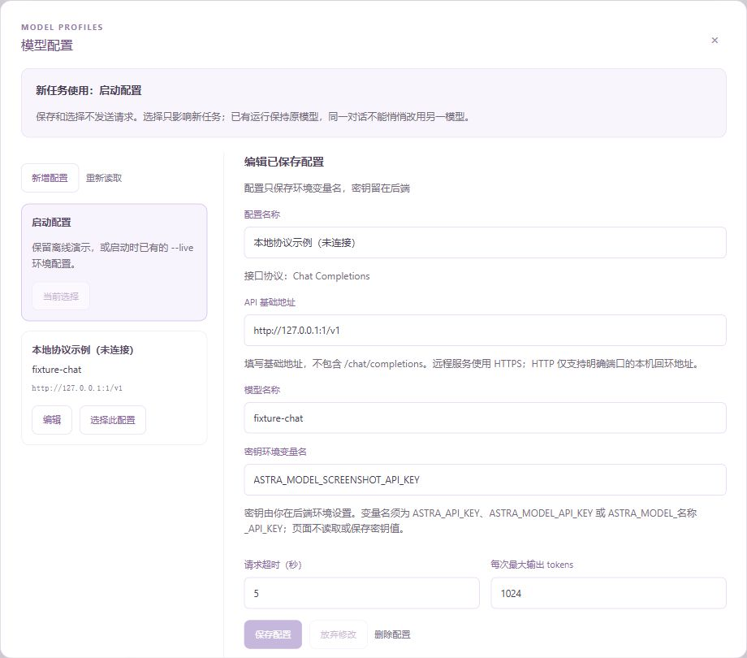

# 任务模型配置档案

[项目首页](../README.md) · [文档地图](README.md) · [当前交接](../HANDOFF.md)

本页说明如何为 Astra 添加、选择和验证自己的任务模型。先完成 [新手入门](GETTING_STARTED.md) 的依赖准备；只想体验执行循环时，使用默认离线示例，无需配置密钥。

模型档案保存显示名称、Chat Completions 基础地址、模型名、密钥环境变量名与请求限制。网页保存的是非秘密配置，密钥由后端进程环境提供。模型决定下一步建议，实际工具调用仍由执行器检查权限、审批和工作区绑定。

**阅读路线：** [离线示例](#先跑不需要真实密钥的示例) → [启动配置与网页选择](#先分清启动配置与网页选择) → [创建档案](#创建非秘密档案) → [设置凭据](#由用户自己设置环境变量) → [显式测试](#显式测试会发送一次请求)。

当前只实现 Chat Completions 兼容适配。MCP 服务使用独立的 [MCP 档案](MCP_PROFILES.md)；[Embedding](EMBEDDING.md) 有独立配置和凭据；[Skill](SKILLS.md) 是单任务指导，不改变模型选择。



上图展示已保存的“本地协议示例”；尚未连接，当前仍选中离线启动配置。保存档案不代表服务已经可用，也不代表真实模型质量。

## 先跑不需要真实密钥的示例

在已安装依赖的项目根目录运行：

```powershell
.\.venv\Scripts\python.exe -X utf8 -m examples.model_profiles_demo
```

[示例源码](../examples/model_profiles_demo.py) 自建回环 HTTP 替身，并注入仅供本地模拟使用的环境映射；不读取用户 `.env` 或真实密钥。它保存并选择 `mock-a`，确认这两步没有请求，显式测试一次，再执行受审批保护的 `7 + 8`。待审批期间把档案改为 `mock-b`，原任务仍返回 `mock-a: 15`；新会话等待审批后关闭重开，继续返回 `mock-b: 15`。

预期 `passed: true`、`mock_requests: 5`、`tool_calls: 2`、`external_provider_requests: 0`：一次诊断请求，加上两个任务各两次模型协议请求。它验证配置与真实工具结果的数据流，不是真实语言模型质量或收费服务联调。示例结束关闭自建服务；无参数时把结果保留在输出所示的系统临时目录。

也可使用自己的全新证据目录，已有目录会被拒绝：

```powershell
$ModelProof = Join-Path $env:TEMP ("astra-model-proof-" + [guid]::NewGuid().ToString("N"))
.\.venv\Scripts\python.exe -X utf8 -m examples.model_profiles_demo --output-dir "$ModelProof"
Get-Content -LiteralPath (Join-Path $ModelProof "result.json") -Encoding UTF8
```

`result.json` 记录请求模型序列、两个答案及测试结果，SQLite 保留运行和档案。演示属于源码与 sdist；wheel 不包含 examples 入口。

## 先分清启动配置与网页选择

| 入口 | 新任务使用的模型 |
| --- | --- |
| 新数据库，启动 `serve`，没有 `--live` 且未选择档案 | 本地规则 DemoModel。 |
| `serve --live --env-file .env` 的启动配置 | 原来的三个 ASTRA 字段提供的模型。 |
| 网页选择某个档案 | 后续新对话使用该档案；旧运行保留原模型。 |
| 用同一数据库重开 `serve` | 恢复保存的档案选择；即使没有 `--live`，也可能使用外部模型。 |
| CLI `run` | 使用本次启动配置，不跟随网页保存的选择，也不改写它。 |
| 控制或恢复已有运行 | 使用运行保存的配置快照，并重新核对身份与凭据。 |

因此，“没有 `--live`”只说明启动配置没有启用真实模型，不能证明重开的网页服务当前选择一定离线。提交任务前先看当前模型。选择 **使用启动配置** 会回到该次启动的模型；若服务本身带了 `--live`，这也不是切回离线模型。

初次练习可在项目根目录的 PowerShell 中为服务使用新数据库：

```powershell
$ProfilePractice = Join-Path $env:TEMP ("astra-model-profiles-" + [guid]::NewGuid().ToString("N"))
.\.venv\Scripts\python.exe -X utf8 -m astra_harness serve `
  --workspace (Join-Path $ProfilePractice "workspace") `
  --database (Join-Path $ProfilePractice "state/runs.sqlite3") --port 18771
```

打开终端显示的本地地址。这个全新数据库没有保存的档案选择，启动模型为离线规则替身；仅查看、保存、修改、删除或选择档案不会请求供应商。不要为了观察界面就点击测试或提交外部模型任务。安装准备见 [新手入门](GETTING_STARTED.md)。

## 创建非秘密档案

新建表单中的地址、模型和密钥环境变量名从空值开始，协议固定为 `chat_completions`。根据自己明确选定的服务填写，不把示例或其他人的模型名当作可用配置。

1. 从侧栏 **模型配置** 或顶部模型按钮打开面板，点 **新增配置**。
2. 填写名称、基础地址、模型名和密钥环境变量名，核对请求限制，点 **保存配置**。新建不会自动选中，也不会发送测试请求。
3. 在列表点 **选择此配置**，核对页面当前模型；已有对话身份不符时点 **新建对话**，不要继续发送旧历史。
4. 要修改已保存档案，点 **编辑**，再保存；**放弃修改** 不改变已保存值，**重新读取** 用于核对后端最新状态。关闭面板可保留本页内存草稿，但刷新页面会丢失未保存内容。
5. 删除在编辑已保存项时使用 **删除配置 → 确认删除**，也可 **取消删除**。有活动引用时会明确拒绝，详见下方运行绑定规则。

| 字段 | 含义与当前限制 |
| --- | --- |
| 名称 | 本地识别用的显示名称，去除首尾空白后 1–80 个字符。 |
| `base_url` | 服务基础地址，不包含末尾 `/chat/completions`；不是任意网页地址。 |
| `model` | 供应商接受的确切模型标识，1–128 个无空格可见 ASCII 字符。 |
| `key_env` | 后端密钥所在的环境变量**名称**，例如 `ASTRA_MODEL_PRIMARY_API_KEY`；这里不填写密钥值。 |
| `timeout` | 单次请求期限，1–120 秒；适配器默认 30 秒。 |
| `max_output_tokens` | 请求输出上限，1–32,768；网页新建初始值 1,024，底层未传该字段时默认 2,048，仍须符合供应商实际限制。 |

每份运行数据库最多保存 16 个档案。系统生成档案 ID、记录修订号及适配器修订身份，供选择、并发更新和恢复检查使用；档案内容改变才增加其修订号。不要在模型名、地址、名称或其他文本字段塞入密钥；接口不接受自定义认证头或明文密钥字段。

保存、选择和删除都核对整个档案目录的修订号。另一页面先修改了配置时，旧提交会被拒绝；先重新读取，再核对并提交自己的修改，不自动覆盖。这些操作不读取密钥环境变量，缺少密钥也可保存或选择，不能据此证明模型可用。**使用启动配置** 表示清除档案选择，不删除任何档案；档案通过选择生效，没有另设“启用／停用”字段。

## 由用户自己设置环境变量

任务模型档案接受 `ASTRA_MODEL_API_KEY`、角色名称如 `ASTRA_MODEL_PRIMARY_API_KEY`，以及兼容名称 `ASTRA_API_KEY`；embedding 的变量不能借作任务模型凭据。请让表单中的 `key_env` 与实际变量名完全一致。

**不要把新档案变量追加到旧 `.env` 文件。** `--env-file` 仍只解析启动兼容入口的 `ASTRA_API_KEY`、`ASTRA_MODEL`、`ASTRA_BASE_URL`，没有变成任意环境文件加载器。新档案通过后端进程环境引用密钥。

如果要接入自己的真实服务，先正常停止服务，再在将要启动它的同一个 PowerShell 窗口自行输入密钥：

```powershell
$ModelSecret = Read-Host "输入你自己的任务模型密钥" -AsSecureString
$ModelCredential = [System.Management.Automation.PSCredential]::new("model", $ModelSecret)
$env:ASTRA_MODEL_PRIMARY_API_KEY = $ModelCredential.GetNetworkCredential().Password
Remove-Variable ModelCredential, ModelSecret
```

随后从这个终端重新启动原服务。命令不会把密钥字面量写进历史或创建持久密钥文件，但密钥仍存在于本机进程环境和内存中；清理变量不等于安全擦除。已启动的服务不会继承后来在另一个终端设置的变量。

网页不提供明文密钥输入或回显；实际任务绑定或显式测试时才检查所引用的环境变量。环境变量存在不等于供应商认证成功；缺少凭据时不能静默改用其他模型。更换凭据可能使旧运行恢复检查失败，见下方恢复规则。

## 显式测试会发送一次请求

测试连接与配置保存分开。先保存档案，再点 **编辑**，核对地址和模型，勾选 **我确认向所示地址发送固定合成文本，并知悉可能产生费用。**，再点击 **测试连接**。这是授权发送请求，不是静态诊断；真实供应商是否计费由其规则决定。

测试只发送固定的 `Reply with OK.`，不附带会话历史、工作区文件或工具定义；最多发起一次请求，不自动重试。请求输出上限取档案值与 32 的较小值，请求期限不超过 10 秒，响应正文不超过 65,536 字节。它们是请求和响应限制，**不是人民币硬预算，也不能保证供应商没有其他计费**。

结果只显示是否完成、请求是否已经开始、请求的模型名，以及供应商实际报告的 usage 或固定错误；不把供应商原始回答展示成测试内容。结果关联被测试的档案身份和修订号，不能把旧测试当成编辑后新配置的验证。一次只允许一项测试；它不创建 Agent 运行记录，不能只看任务的 `model_calls` 判断测试是否发了请求。缺失 usage 不按零计算。测试成功只说明这次合成请求经过了当前适配路径，不证明工具调用、长上下文、真实任务质量或全部模型能力。

点击 **停止等待测试**、关闭面板、超时或断线不证明请求没有到达服务端，也不保证停止计费。请求已发出而结果不明时，先保留并核对结果，不自动重试；重新点击意味着用户再次授权一项可能计费的请求。`doctor --live` 仍是零网络的启动静态检查，不能替代这里的显式测试。

## 旧运行不会跟着模型选项改变

新 Agent 运行保存非秘密档案快照和模型身份。任务开始后编辑档案、选择其他档案或切回启动配置，都不重定向已经提交的任务。恢复时使用保存的快照，不用档案列表中的最新值替换它；同进程旧运行继续使用已经绑定的模型对象。

会话也有模型边界。选择不同身份的模型后，旧 Agent 会话不能直接继续；页面会要求 **新建对话**。修改同一档案的修订号也属于身份变化，不能以“名称相同”为由把旧历史发送给新端点。直接工具操作不需要模型档案，不会为了运行本地工具而请求模型。

重开时重新核对模型身份及后端凭据的私有校验值。没有在途调用标记的旧未完成运行，遇到缺少密钥、凭据轮换或配置不符会明确失败；已有在途标记时优先遵守原中断规则，副作用结果不明仍保持 `unknown`。两者都不悄悄回退启动模型，不自动发请求验证或重放任务。私有凭据校验值不通过网页运行接口返回，也不是给用户复制使用的密钥摘要。

删除档案不删除历史运行的快照或实际产物。有未结束运行或尚未核查的 unknown 引用它时，删除会被拒绝。删除当前选中的档案时，选择回到启动配置；如果服务带了 `--live`，新的启动配置任务仍可能计费。不要通过手改 SQLite 绕过引用与恢复检查。运行数据库仍只允许一个主机进程，CLI 控制已有任务前应先停止网页服务，详见 [工作区指南](WORKSPACES.md)。

## 地址与验证范围

档案只允许用户明确信任的 HTTPS 公网服务，HTTP 只允许带显式端口的数字回环地址。拒绝地址中的用户名、密码、查询、片段及不明确路径；没有代理、重定向、Cookie 或隐式请求重试。HTTPS 请求发送凭据前检查 DNS 返回地址，但 HTTPX 会再次解析，仍存在两次解析之间的变化窗口，不是完整 SSRF 防护或网络沙箱。

本页示例使用可信本地模拟服务，真实模型质量、服务可用性与费用不能由模拟结果推断。配置编辑后，应按新身份重新检查；另一份配置的结果不能代替当前服务验证。实际实现见 [档案适配器](../astra_harness/builtin/model_profile_adapter.py)，验证方法与局限见 [评测说明](EVALUATION.md)；MCP 连接生命周期见 [MCP 档案指南](MCP_PROFILES.md)，单任务指导见 [Skill 指南](SKILLS.md)。

下一步：用 [演示路线](DEMO.md) 核对审批、暂停与恢复；需要实现另一种模型协议时，阅读 [扩展指南](EXTENDING.md)。
